# Manual do SAC — ACN Sinal Verde

# Antes de começar

## Para quem é este manual

Este manual é para quem trabalha no **SAC**: abrir e acompanhar Ordens de Serviço (OS), atender chamados, conduzir os atendimentos em garantia e manter os cadastros. Ele mostra cada tela, o que cada botão faz, **o que o sistema grava** quando você clica e **para onde a OS vai** depois.

Todas as fotos usam **dados de exemplo** (clientes, veículos e nomes inventados). Nenhuma OS real aparece aqui.

**Como cada passo a passo está escrito**

- **Quando usar:** a situação em que você precisa daquele passo.
- **Quem faz:** quem tem o botão (você, o Laboratório, a Produção, a Qualidade, o Fiscal ou o cliente).
- **Passo a passo:** os cliques, na ordem.
- **O que acontece:** o que o sistema grava e quem é avisado.
- **Vai para:** a etapa seguinte da OS e quem age nela.

> **Dica:** os botões aparecem em **negrito**. O símbolo **⋯** é o menu de três pontinhos no fim de cada OS: as ações menos usadas ficam nele.

> **Atenção:** quando o texto vier numa caixa vermelha como esta, é algo que pode travar o trabalho ou apagar um registro. Leia antes de clicar.

## O SAC em uma página

O SAC tem **quatro abas**, no alto da tela:

| Aba | Para que serve | Quando você usa |
|---|---|---|
| **Ordens de Serviço** | Todo serviço em equipamento do Laboratório ou em veículo: orçamento, conserto, troca, garantia. É a aba principal | O dia todo |
| **Chamados NFC** | Chamados de suporte que o cliente abre sozinho pelo veículo (etiqueta NFC) | Para atender quem pediu ajuda |
| **Garantia** | A **ficha** de cada atendimento em garantia: avaliação, fornecedor, custos, autorização, peças, apontamentos | Antes de abrir qualquer OS de garantia |
| **Cadastros** | As listas que alimentam a Nova OS: tipos de equipamento, categorias e tipos de serviço | De vez em quando |

Acima das abas fica a **Agenda do SAC**: compromissos do setor, que você marca como concluídos ou exclui.

### A viagem de uma OS

Toda OS passa por **etapas**. Em cada etapa existe **uma** pessoa ou setor que precisa agir. O sistema mostra isso em cada OS com a linha **"Aguarda: …"**.

FLUXO: SAC abre a OS > Laboratório ou Produção avalia > SAC envia o orçamento ao cliente > Cliente aprova > Laboratório ou Produção executa > Qualidade confere (veículo) > SAC envia ao Fiscal > Fiscal emite a nota > SAC entrega ao cliente

Duas variações importantes:

- **OS sem cobrança** (garantia dentro da cobertura ou cortesia): **não tem orçamento nem aprovação do cliente e não vai ao Fiscal**. Termina na entrega.
- **OS de veículo**: a Produção marca a data, o SAC confirma com o cliente (o **aceite**), a Produção executa e a **Qualidade** confere antes de a OS voltar ao SAC.

### Quem é quem nas etapas

| Quem | O que faz na OS |
|---|---|
| **SAC** (você) | Abre a OS, envia orçamento, registra a resposta do cliente, confirma a data do veículo, envia ao Fiscal, entrega, cancela |
| **Laboratório** | Diagnostica e executa o conserto dos equipamentos |
| **Produção** | Marca a data, recebe o veículo, verifica, orça e executa a manutenção veicular |
| **Qualidade (CQ)** | Confere o serviço do veículo antes de voltar ao SAC |
| **Fiscal** | Emite a nota fiscal das OS cobradas |
| **Cliente** | Aprova ou recusa o orçamento e retira o equipamento |

## Palavras que aparecem na tela

| Palavra | O que significa |
|---|---|
| **OS** | Ordem de Serviço. Número no formato **OS-0044/2026** (sequência do ano) |
| **Etapa** | Em que ponto do caminho a OS está (aparece como selo colorido) |
| **Aguarda** | Quem precisa agir agora (SAC, Laboratório, Produção, Qualidade, Fiscal ou Cliente) |
| **OS parada** | OS que está **7 dias ou mais** na mesma etapa. Aparece em vermelho |
| **Cobrada / Sem cobrança** | Se o serviço será faturado ao cliente ou não (garantia ou cortesia) |
| **Lote** | Várias OS abertas juntas (por exemplo, 7 viaturas do mesmo cliente). Aparecem num cartão só no quadro |
| **Ficha** | O atendimento em garantia da aba **Garantia** (número **GAR-0001/2026**) |
| **PV** | Pedido de venda, quando a OS veio de uma venda do CRM |
| **Provisionamento** | Marcar a data em que o veículo será atendido |
| **Aceite SAC** | Você confirma com o cliente a data marcada pela Produção |
| **CQ** | Controle de Qualidade: a Qualidade confere o serviço do veículo |
| **Cortesia** | Serviço entregue sem cobrar, com motivo registrado |
| **Atendimento já realizado** | Serviço que foi feito fora da fábrica antes de a OS ser concluída no sistema |

---

# Aba Ordens de Serviço

## A tela, de cima para baixo

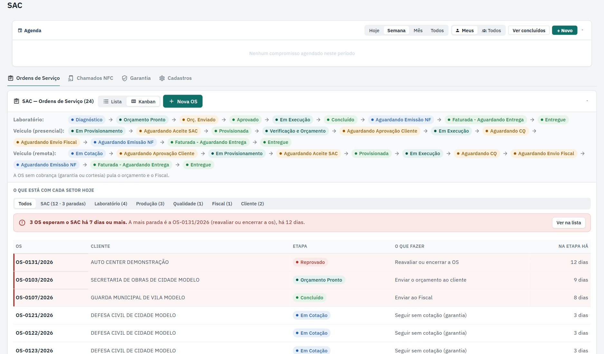

A tela tem sete partes, nesta ordem:

1. **Agenda do SAC.** Compromissos do setor. Filtros **Hoje, Semana, Mês, Todos**; **Meus** ou **Todos**; **Ver concluídos**. O botão **+ Nova** abre o *Novo Compromisso*: título, descrição (use **@Nome** para avisar alguém), data e hora e os participantes.
2. **As quatro abas** (Ordens de Serviço, Chamados NFC, Garantia, Cadastros).
3. **O título "SAC — Ordens de Serviço (N)"** com o número de OS que passam pelos filtros, o seletor **Lista | Kanban** e o botão verde **Nova OS**.
4. **A legenda de fluxo.** Três linhas com as etapas de cada caminho (Laboratório, Veículo presencial, Veículo remota). Serve de consulta: mostra por quais etapas a OS passa.
5. **O painel "O que está com cada setor hoje".**
6. **Os filtros.**
7. **O quadro (Kanban) ou a lista.**

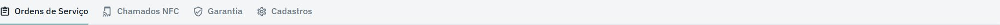

### O painel "O que está com cada setor hoje"

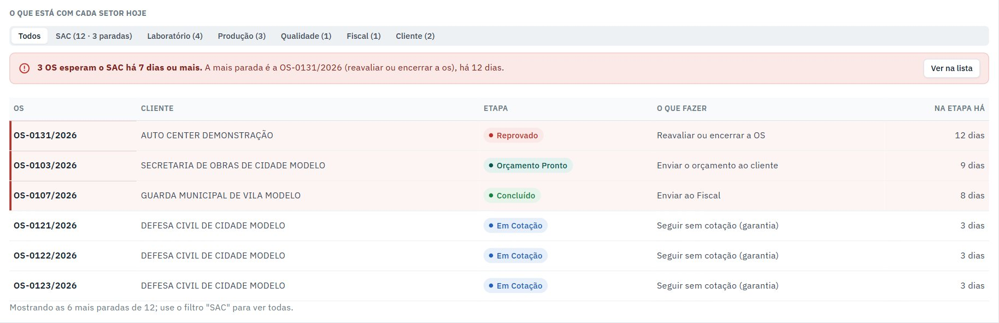

- Os botões **SAC, Laboratório, Produção, Qualidade, Fiscal, Cliente** mostram quantas OS aguardam cada um e quantas já estão paradas (por exemplo, *SAC (12 · 3 paradas)*). **Clique num deles** para filtrar o quadro e a lista só com as OS daquele setor. **Todos** limpa.
- A **faixa vermelha** aparece quando há OS esperando o SAC há 7 dias ou mais. Diz qual é a mais parada. O botão **Ver na lista** abre a lista já filtrada por SAC e por "paradas".
- A **tabela** mostra as **6 OS mais paradas que são do SAC**, com a etapa, **o que fazer** e **há quantos dias** a OS está na etapa. Para ver todas, use o botão **SAC** do painel.

> **Dica:** comece o dia pela faixa vermelha. Ela lista justamente o que está esperando por você.

### Os filtros

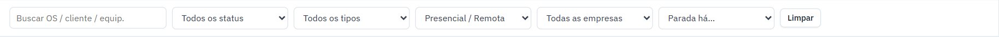

| Filtro | O que faz |
|---|---|
| **Buscar OS / cliente / equip.** | Procura pelo número da OS, nome do cliente ou equipamento. Não diferencia acento nem maiúscula |
| **Todos os status** | Mostra só uma etapa (por exemplo, "Orç. Enviado") |
| **Todos os tipos** | Orçamento, Conserto, Troca ou Garantia |
| **Presencial / Remota** | **Veiculares** (todas as OS de veículo), **Presencial** ou **Remota** |
| **Todas as empresas** | ACN, DETECH ou **Sem empresa** (OS antigas) |
| **Parada há…** | OS paradas há 7, 15 ou 30 dias ou mais |
| **Limpar** | Desliga todos os filtros de uma vez, incluindo o painel e a busca |

> **Atenção:** se uma OS "sumiu", confira se há filtro ligado (o número em "(N)" no título diz quantas passaram). As OS **Reprovadas** e **Canceladas** não aparecem no quadro: ficam na lista, pelo filtro de status.

### O quadro (Kanban)

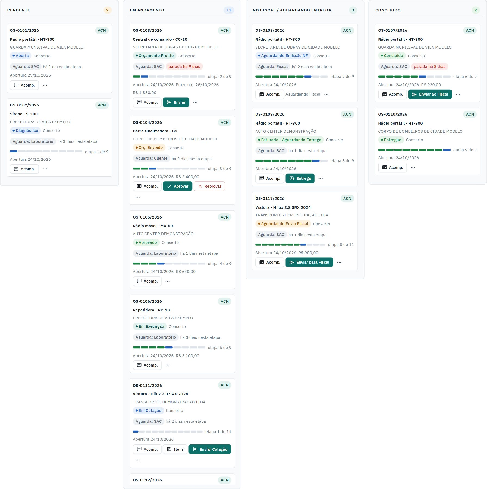

O quadro tem **quatro colunas**. Cada OS fica na coluna da etapa em que está:

| Coluna | Etapas dentro dela |
|---|---|
| **PENDENTE** | Aberta, Diagnóstico |
| **EM ANDAMENTO** | Orçamento Pronto, Orç. Enviado, Aprovado, Em Execução, Em Cotação, Aguardando Aprovação Cliente, Em Provisionamento, Aguardando Aceite SAC, Provisionada, Aguardando Início, Verificação e Orçamento, Aguardando CQ |
| **NO FISCAL / AGUARDANDO ENTREGA** | Aguardando Envio Fiscal, Aguardando Emissão NF, Faturada - Aguardando Entrega |
| **CONCLUÍDO** | Concluído, Entregue |

O número no canto de cada coluna é a quantidade de cartões. Você pode **arrastar o cartão** de uma coluna para outra: veja *Mover a OS entre as etapas*.

Duas faixas podem aparecer acima do quadro: **"N OS reprovadas ficam fora do quadro"** e **"N OS canceladas ficam fora do quadro e da lista"**. O botão **Ver na lista** leva até elas.

### A lista

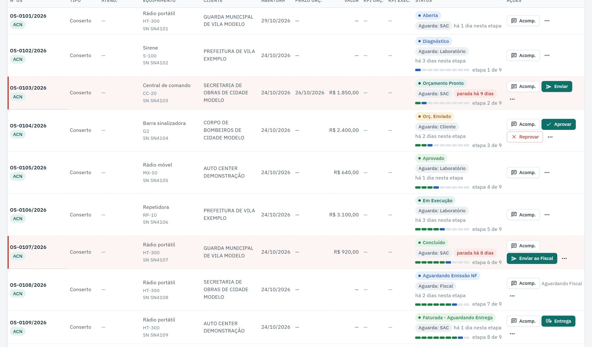

Mostra as mesmas OS em linhas. As colunas são: **Nº OS** (com empresa, PV, ficha e lote), **Tipo**, **Atend.** (Presencial ou Remota), **Equipamento**, **Cliente**, **Abertura**, **Prazo Orç.**, **Valor**, **KPI Orç.**, **KPI Exec.**, **Status** e **Ações**.

- A linha fica **rosada** quando a OS está **Reprovada** ou **parada**.
- **KPI Exec.** só aparece na OS remota: compara as **horas cobradas na cotação** com as **horas reais** apontadas pela Produção. **▲** quer dizer que você cobrou mais horas do que a Produção levou; **▼**, menos.
- Os botões da coluna **Ações** são os mesmos do cartão do quadro.

## Como ler o cartão de uma OS

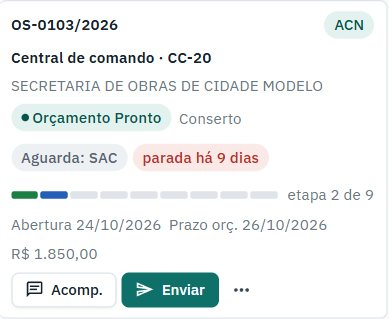

| O que você vê | O que significa |
|---|---|
| **OS-0103/2026** | Número da OS |
| **ACN** ou **DETECH** | Empresa da OS. **Clique** para trocar (ou para definir, em OS antiga sem empresa) |
| **PV 0999** | Pedido de venda de origem, quando a OS veio do CRM |
| **Ficha GAR-0003/2026** | A ficha de garantia da OS. **Clique** para abrir a ficha |
| **Lote** | A OS faz parte de um lote |
| **Central de comando · CC-20** | Equipamento e modelo |
| Nome do cliente | Cliente |
| **Selo colorido** (por exemplo, *Orçamento Pronto*) | A etapa atual, seguida do tipo de serviço |
| **Aguarda: SAC** | Quem tem que agir agora |
| **há 3 dias nesta etapa** | Tempo na etapa. Vira **"parada há 9 dias"**, em vermelho, a partir de 7 dias |
| **Barra com "etapa 2 de 9"** | Quanto da viagem a OS já fez, pelo caminho dela. As partes **verdes** estão feitas, a **azul** é a atual |
| **Abertura, Prazo orç., R$** | Datas e valor |
| **Acomp.** | Acompanhamento da OS (anotações do setor) |
| **Botão verde** (por exemplo, **Enviar**) | O passo que a OS espera de **você** nesta etapa |
| **⋯** | Menu com as outras ações |

> **Dica:** **clique no cartão** (fora dos botões) para abrir o **resumo completo** da OS: andamento, dados do serviço e do cliente, valores, itens, compras, responsáveis, observações, arquivos e fotos.

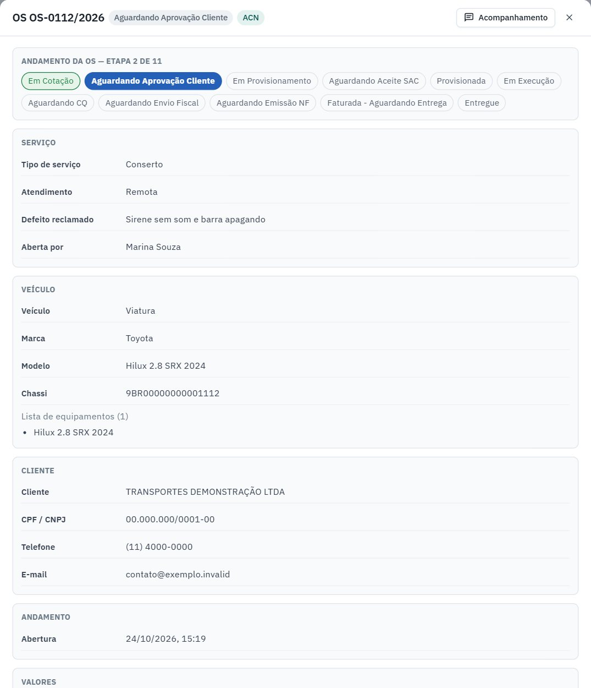

Quando a etapa é de **outro setor**, no lugar do botão verde aparece um texto cinza: **"Aguardando Qualidade"**, **"Aguardando Fiscal"**, **"Aguardando o Laboratório iniciar"** ou **"Em execução no Laboratório"**. Não há nada a fazer até o setor agir.

## Os caminhos da OS

Cada OS segue **um** dos cinco caminhos abaixo. A barra de progresso do cartão mostra o caminho dela.

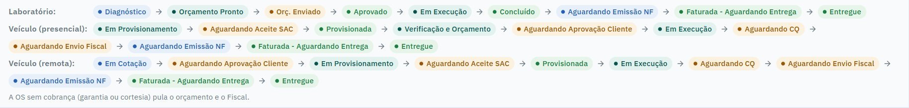

### Caminho 1: Laboratório, cobrada

FLUXO: Diagnóstico > Orçamento Pronto > Orç. Enviado > Aprovado > Em Execução > Concluído > Aguardando Emissão NF > Faturada - Aguardando Entrega > Entregue

| Etapa | Quem age | O que acontece | Vai para |
|---|---|---|---|
| **Diagnóstico** | Laboratório | A OS nasce aqui e o Laboratório recebe uma demanda de diagnóstico. Ele examina e informa o valor | Orçamento Pronto |
| **Orçamento Pronto** | **SAC** | Você envia o orçamento ao cliente | Orç. Enviado |
| **Orç. Enviado** | Cliente (o SAC cobra) | Você registra a resposta: **Aprovar** ou **Reprovar** | Aprovado ou Reprovado |
| **Aprovado** | Laboratório | Nasce a demanda de execução. O Laboratório inicia | Em Execução |
| **Em Execução** | Laboratório | Conserto em andamento | Concluído |
| **Concluído** | **SAC** | Você envia ao Fiscal (valor e CPF/CNPJ da nota) | Aguardando Emissão NF |
| **Aguardando Emissão NF** | Fiscal | O Fiscal emite a nota | Faturada - Aguardando Entrega |
| **Faturada - Aguardando Entrega** | **SAC** | Você entrega ao cliente, com assinatura | Entregue |

### Caminho 2: Laboratório, sem cobrança

FLUXO: Aprovado > Em Execução > Concluído > Entregue

A OS **já nasce "Aprovado"** (aprovação automática) e o Laboratório recebe a demanda de execução na hora. Depois de **Concluído**, o SAC faz a **Entrega**. Não há orçamento e **não vai ao Fiscal**.

### Caminho 3: veículo, avaliação remota, cobrada

FLUXO: Em Cotação > Aguardando Aprovação Cliente > Em Provisionamento > Aguardando Aceite SAC > Aguardando Início > Em Execução > Aguardando CQ > Aguardando Envio Fiscal > Aguardando Emissão NF > Faturada - Aguardando Entrega > Entregue

Na avaliação **remota** o preço sai **antes** de o veículo chegar. Você monta os itens da cotação e envia ao cliente. Só depois de aprovada a Produção marca a data.

| Etapa | Quem age | O que acontece |
|---|---|---|
| **Em Cotação** | **SAC** | Monta os **Itens** e usa **Enviar Cotação** |
| **Aguardando Aprovação Cliente** | Cliente (o SAC registra) | **Aprovado** ou **Recusado** |
| **Em Provisionamento** | Produção | Marca a data e o período do atendimento |
| **Aguardando Aceite SAC** | **SAC** | Confirma a data com o cliente |
| **Aguardando Início** | Produção | Recebe o veículo e inicia |
| **Em Execução** | Produção | Manutenção em andamento |
| **Aguardando CQ** | Qualidade | Confere o serviço |
| **Aguardando Envio Fiscal** | **SAC** | Informa o número de série de cada item e envia ao Fiscal |
| **Aguardando Emissão NF** | Fiscal | Emite a nota |
| **Faturada - Aguardando Entrega** | **SAC** | Entrega o veículo |

### Caminho 4: veículo, avaliação presencial, cobrada

FLUXO: Em Provisionamento > Aguardando Aceite SAC > Provisionada > Verificação e Orçamento > Aguardando Aprovação Cliente > Aguardando Início > Em Execução > Aguardando CQ > Aguardando Envio Fiscal > Aguardando Emissão NF > Faturada - Aguardando Entrega > Entregue

Na avaliação **presencial** o veículo vem primeiro e o orçamento sai da **verificação** feita pela Produção.

| Etapa | Quem age | O que acontece |
|---|---|---|
| **Em Provisionamento** | Produção | Marca a data do atendimento |
| **Aguardando Aceite SAC** | **SAC** | Confirma a data com o cliente |
| **Provisionada** | Produção | Aguarda o veículo. Quando ele chega, a Produção marca **Chegou** |
| **Verificação e Orçamento** | Produção | Examina o veículo e **insere os materiais** do orçamento |
| **Aguardando Aprovação Cliente** | **SAC** | Você vê (ou edita) o orçamento e registra **Aprovado** ou **Recusado** |
| **Aguardando Início** | Produção | Atribui o técnico e inicia |
| **Em Execução, Aguardando CQ** | Produção, Qualidade | Executam e conferem |
| **Aguardando Envio Fiscal** e depois | **SAC**, Fiscal | Igual ao caminho 3 |

> **Atenção:** a barra de progresso do cartão, neste caminho, **volta uma casa** quando você aprova o orçamento (a etapa "Aguardando Início" é desenhada como "Provisionada"). A OS não voltou: é só o desenho da barra.

### Caminho 5: veículo, sem cobrança (garantia ou cortesia)

FLUXO: Em Provisionamento > Aguardando Aceite SAC > Provisionada > Em Execução > Aguardando CQ > Concluído > Entregue

A OS **nasce em "Em Provisionamento"**, sem cotação. A Produção marca a data, o SAC dá o **aceite**, o veículo é atendido e, depois da Qualidade, a OS vai direto a **Concluído**; o SAC faz a **Entrega** do veículo. **Não vai ao Fiscal.**

> **Atenção:** pelo que a tela da Produção faz hoje (conferido no código, **ainda não visto acontecendo**), o veículo desta OS pode passar por **"Verificação e Orçamento"** e por **"Aguardando Aprovação Cliente"** (onde aparecem os botões **Aprovado** e **Recusado** do SAC) antes de iniciar. Se isso acontecer, clique **Aprovado**. Nessas etapas e na do aceite, a **barra de progresso some**, porque elas não fazem parte do caminho da OS sem cobrança. A diferença entre este caminho e o que a Produção faz está registrada como ponto de melhoria (**a confirmar** com a Produção).

### Caminho 6: OS lançada pelo card do CRM

A OS que nasce da **venda** (janela *Nova OP / OS* do card do CRM) já vem **vendida**: cobrada, aprovada, **sem cotação**, com o valor da venda e o pedido de venda (selo **PV**). Quem lançou escolheu **quem executa**:

- **Laboratório:** nasce **Aprovado** e o Laboratório recebe a demanda de execução. No cartão aparece **"Aguardando o Laboratório iniciar"** e depois **"Em execução no Laboratório"**.
- **O SAC conclui:** nasce **Em Execução** e o botão verde é **Concluir OS**.

Depois de **Concluído**, a OS segue o caminho 1: **Enviar ao Fiscal** e **Entrega**.

---

## Passo a passo: abrir uma OS (Nova OS)

**Quando usar:** um cliente trouxe (ou vai trazer) um equipamento, ou pediu um serviço no veículo. Toda OS começa aqui, **menos a de garantia, que começa pela ficha** (aba Garantia, veja a Parte 4).

**Quem faz:** o SAC (e quem tem a aba SAC liberada).

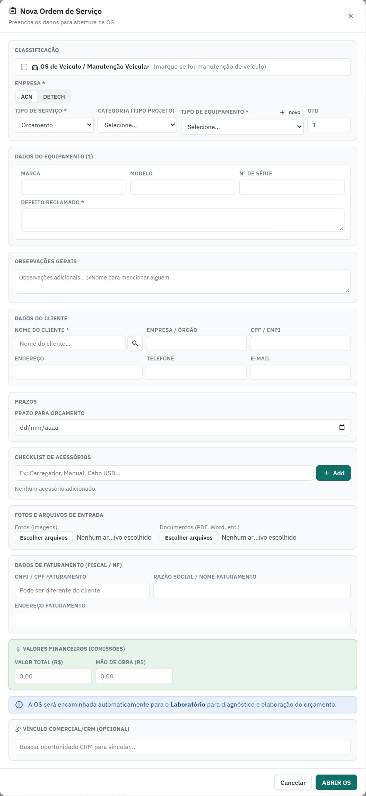

### Passo a passo

1. Na aba **Ordens de Serviço**, clique em **Nova OS** (botão verde, ao lado do título).
2. **Classificação.** Escolha o que é a OS:
   - **Empresa:** ACN ou DETECH (a empresa que vai faturar).
   - **Tipo de serviço\*:** Orçamento, Conserto, Troca ou Garantia (a lista vem da aba Cadastros).
   - **Categoria (tipo projeto):** o grupo do serviço (por exemplo, Manutenção Veicular, Serviço Externo, Laboratório).
   - **Tipo de equipamento\*:** o aparelho (Barra sinalizadora, Central de comando, Rádio portátil...). Se não existe, use **+ novo**: ele pede o nome e cadastra na hora.
   - **Qtd:** quantos equipamentos iguais (de 1 a 20).
   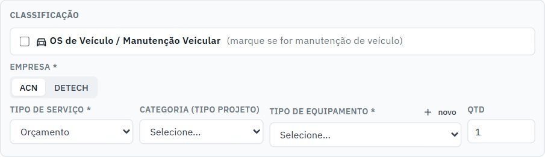
3. **Se for manutenção em veículo**, marque a caixa **OS de Veículo / Manutenção Veicular**. Aparecem a **Manutenção Veicular** e a escolha do **Tipo de avaliação**: veja [OS de veículo](#os-de-veículo) abaixo.
4. **Dados do equipamento.** Para cada equipamento:
   - **Marca**, **Modelo** (na OS de veículo, no lugar do Modelo você escolhe o **Veículo do catálogo**; se ele não existe, **+ Novo** cadastra) e **Nº de série** (na OS de veículo, o **Chassi**);
   - **Defeito reclamado\*:** o que o cliente relata. **É obrigatório em cada equipamento.**
   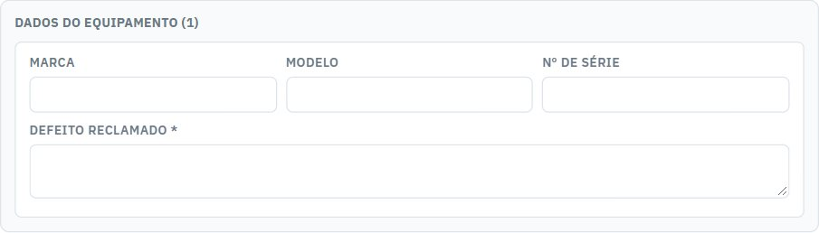
5. **Observações gerais** (opcional). Escreva **@Nome** para avisar alguém: a pessoa recebe a menção na caixa de Menções (o sino).
   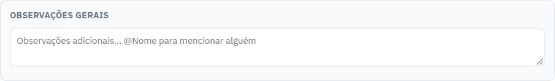
6. **Dados do cliente.** Digite o **Nome do cliente\*** e escolha na lista (a lupa): o sistema preenche empresa/órgão, CPF/CNPJ, endereço, telefone e e-mail do cadastro de clientes. Cliente novo? Digite tudo; ele fica guardado para a próxima vez.
   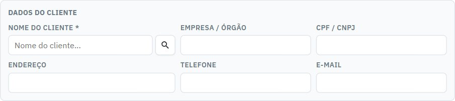
7. **Prazos.** O **Prazo para orçamento** é opcional e aparece no cartão e na lista. Na garantia, no lugar dele aparece a **Data prevista de entrega**.
   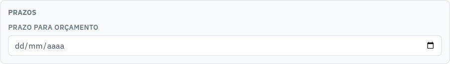
8. **Checklist de acessórios.** Digite cada acessório que veio junto (carregador, cabo, manual) e clique **+ Add** (ou tecle Enter). Cada acessório entra com a caixa **marcada** (veio junto); **desmarque** se ele não veio. O **×** tira o acessório da lista (o sistema pede confirmação).
   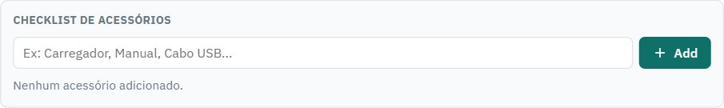
9. **Fotos e arquivos de entrada.** Fotos do equipamento como chegou e documentos (PDF, Word). Se algum arquivo não subir, **a OS não abre** e o sistema diz qual arquivo falhou: corrija ou tire o arquivo da lista.
   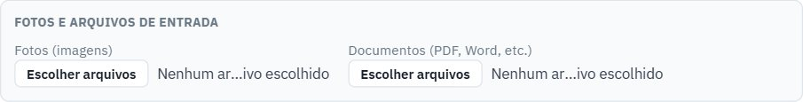
10. **Dados de faturamento** (opcional): CNPJ/CPF, razão social e endereço **da nota**, quando diferentes do cliente. *Este bloco **some** na OS de garantia sem cobrança, porque ela não tem nota.*
    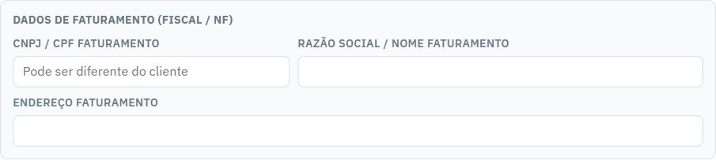
11. **Valores financeiros (comissões)** (opcional): **Valor total** e **Mão de obra**. É o que a comissão lê; pode ficar vazio e ser preenchido depois pelo menu ⋯ **Financeiro**.
    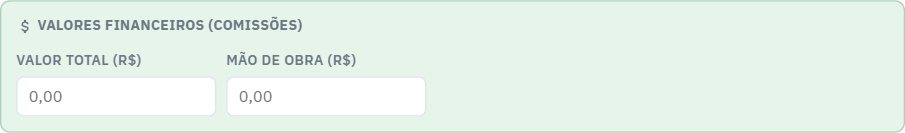
12. **Vínculo comercial/CRM** (opcional): digite pelo menos 2 letras do título ou do órgão e escolha a oportunidade do CRM. É só um **vínculo**: a OS fica ligada à oportunidade, sem copiar nada. **Remover** desfaz.
    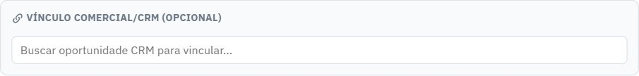
13. Clique **ABRIR OS** (no rodapé). **Cancelar** fecha a janela sem gravar nada.

> **Atenção:** três coisas travam o botão: o **nome do cliente**, o **tipo de equipamento** e o **defeito reclamado** de cada equipamento (e, na garantia, a **ficha**). Se faltar algo, a tela avisa o que é e nada é gravado.

Na janela, uma faixa avisa para onde a OS vai: na OS do Laboratório, *"será encaminhada automaticamente para o Laboratório para diagnóstico e elaboração do orçamento"*; na garantia do Laboratório, *"é aprovada automaticamente: o Laboratório receberá a OS para execução direta"*.

### Vários equipamentos de uma vez (lote)

Aumente a **Qtd**. A janela mostra **um bloco por equipamento** (Equipamento 1 de 3, 2 de 3...). Marque a caixa **"Criar uma OS para cada equipamento (lote)"**: o sistema cria **uma OS para cada um, cada uma com o seu número**, e o quadro mostra o lote **num cartão só**.

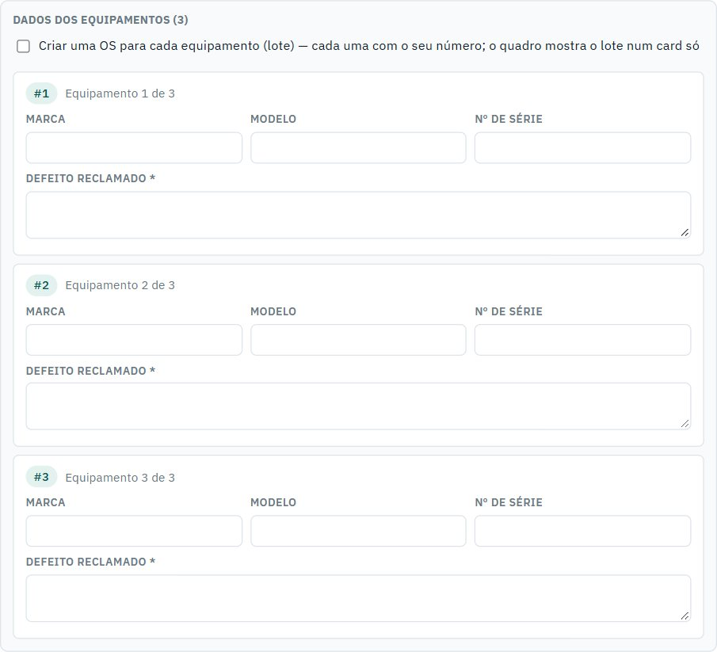

> **Dica:** se você **não** marcar a caixa, é criada **uma OS só** com a lista inteira de equipamentos.

### Despesas de campo

Se a **Categoria** for do tipo que tem despesas (por exemplo, **Serviço Externo**), aparece o bloco **Despesas de campo**: **Deslocamento, Hospedagem e Alimentação**, com o total somado.

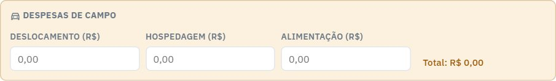

### O que acontece quando você clica em Abrir OS

- O sistema dá o **número** da OS (formato **OS-0123/2026**, uma sequência por ano). Se dois atendentes abrem ao mesmo tempo e o número repete, ele pega o próximo sozinho.
- A OS nasce na **etapa de início do caminho dela**:

| O que você abriu | Nasce em | Quem age em seguida |
|---|---|---|
| Laboratório, cobrada | **Diagnóstico** | Laboratório (recebe a demanda "[SAC-DIAG]") |
| Laboratório, garantia (sem cobrança) | **Aprovado** | Laboratório (recebe a demanda de **execução**, "[SAC-EXEC]") |
| Veículo, avaliação **Remota** | **Em Cotação** | **SAC** monta os itens |
| Veículo, avaliação **Presencial** | **Em Provisionamento** | Produção marca a data |
| Veículo, garantia (sem cobrança) | **Em Provisionamento** | Produção marca a data |

- Se marcou **Acompanhamento de Engenharia**, nasce também uma demanda para a **Engenharia**.
- As **menções (@Nome)** viram avisos na caixa de Menções de quem foi chamado.
- O sistema avisa por **WhatsApp** (se esse aviso estiver ligado na configuração): "Nova OS ..., cliente, equipamento, tipo, aberta por". No lote vai **um aviso só**, com todos os números.
- Se a OS foi criada mas uma **demanda** (Laboratório ou Engenharia) **não** nasceu, o sistema diz qual faltou: avise o PCP ou a TI, porque o setor só enxerga a OS pela demanda.
- O cliente digitado fica salvo no cadastro de clientes.

### OS de veículo

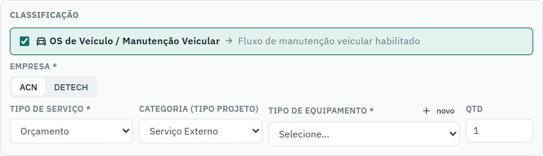

Marque **OS de Veículo / Manutenção Veicular** e escolha o **Tipo de avaliação**:

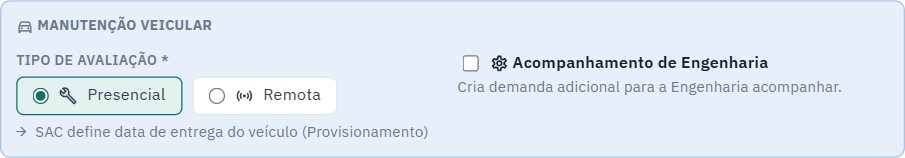

Na **garantia sem cobrança** o bloco não deixa escolher: diz que *"Garantia sem cobrança não tem cotação: a Produção marca a data de atendimento do veículo"* e a OS entra como presencial.

| Tipo de avaliação | Como funciona | Quando escolher |
|---|---|---|
| **Remota** | O preço sai **antes** de o veículo chegar. Você monta a **cotação** (itens e valores) e o cliente aprova. Depois a Produção marca a data | O defeito já é conhecido e dá para orçar sem ver o carro |
| **Presencial** | O **veículo vem primeiro**: a Produção marca a data, o veículo chega, a Produção examina e **insere os materiais** do orçamento. Aí o cliente aprova | O defeito só se descobre com o veículo na oficina |

> **Atenção:** a ajuda que aparece abaixo de "Presencial" na tela diz *"SAC define data de entrega do veículo (Provisionamento)"*. **Está desatualizada**: quem marca a data é a **Produção**; o SAC só dá o **aceite**. Este é um dos pontos de melhoria listados na análise.

**Acompanhamento de Engenharia** (caixa à direita): marque quando a Engenharia precisa acompanhar o serviço. Cria uma demanda a mais para ela.

### OS de garantia: começa pela ficha

Ao escolher **Tipo de serviço = Garantia**, aparece o quadro **Atendimento de garantia (ficha)**. A OS **só abre com a ficha escolhida**.

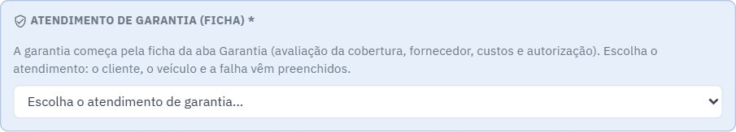

1. Escolha a ficha na lista (só aparecem as fichas **liberadas para gerar OS**: com a **avaliação técnica registrada**). Cliente, contato, veículo, chassi e falha **vêm preenchidos**.
2. Em **Esta OS será**, escolha:
   - **Sem cobrança (garantia ou cortesia)**: não passa por cotação nem aprovação e **não vai ao Fiscal**; termina em Entregue. É a sugestão quando a ficha diz que está dentro da garantia.
   - **Cobrada do cliente**: fora da cobertura; segue o fluxo pago (cotação ou orçamento, aprovação, execução e Fiscal). É a sugestão quando a ficha diz que está fora da garantia.
3. Termine como qualquer OS e clique **Abrir OS**.

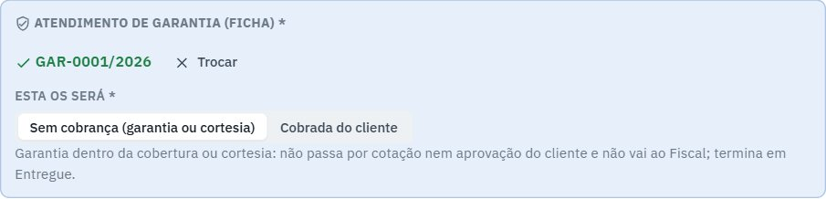

> **Dica:** a forma mais curta é abrir a OS **de dentro da ficha**, com o botão **Gerar OS de execução** (Parte 4): ela já abre a Nova OS preenchida.

**O que acontece depois:** a ficha da garantia **registra no histórico** que a OS nasceu ("Ordem de serviço gerada: OS-0130/2026 (sem cobrança)") e avisa o responsável e os copiados da ficha.

---

## Passo a passo: o que fazer em cada etapa

Em cada OS, o botão **verde** é o passo que **você** precisa dar naquela etapa. Abaixo, cada passo, o que ele pede e para onde a OS vai.

### Enviar o orçamento ao cliente (Laboratório)

**Quando usar:** a OS está em **Orçamento Pronto**. O Laboratório diagnosticou e informou o valor na demanda dele.

**Passo a passo:**

1. No cartão da OS, clique **Enviar** (botão verde).
2. Confira o **Diagnóstico do Lab** (o texto do Laboratório aparece em azul, como apoio).
3. Confira ou digite o **Valor do orçamento (R$)\***.
4. Se quiser, escreva as **Condições de pagamento** (por exemplo, "50% entrada + 50% na retirada").
5. Clique **Enviar ao cliente**.

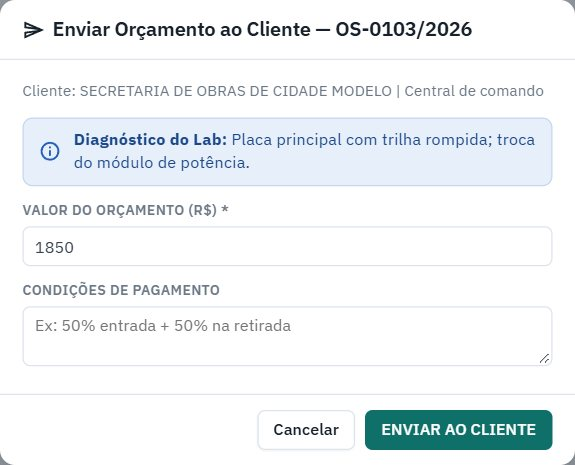

**O que acontece:** a OS grava o valor, as condições e **a data de envio**; o sistema avisa por WhatsApp (se ligado). **O sistema não manda o orçamento ao cliente por e-mail ou WhatsApp**: o SAC envia o orçamento ao cliente pelo meio de costume e usa este botão para **registrar** que enviou.

**Vai para:** **Orç. Enviado**. Quem age: o cliente (você cobra a resposta).

### Registrar a resposta do cliente: aprovar ou reprovar (Laboratório)

**Quando usar:** a OS está em **Orç. Enviado** e o cliente respondeu.

**Se o cliente APROVOU:**

1. Clique **Aprovar** no cartão.
2. Digite o **Nome do aprovador\***.
3. (Opcional) informe a **Data prevista de entrega**.
4. Peça a **assinatura do aprovador\*** e desenhe no quadro (com o dedo ou o mouse). Clique **Confirmar assinatura**. **Limpar** apaga e recomeça.
5. Clique **Confirmar aprovação**.

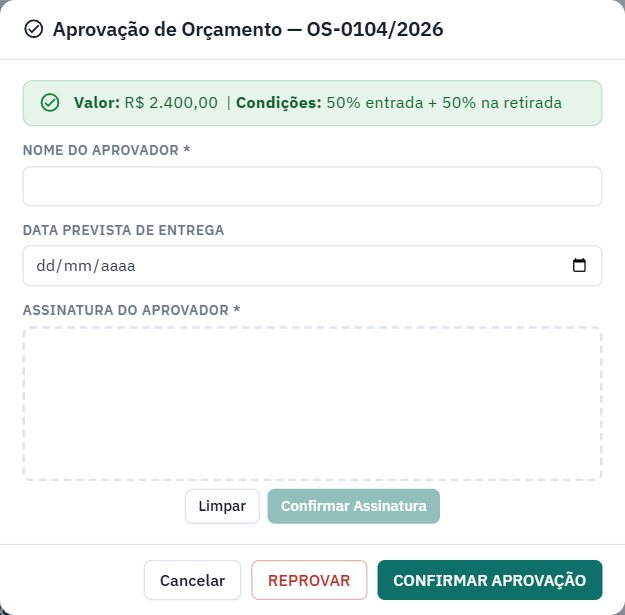

**O que acontece:** a assinatura é guardada na OS; a OS fica **Aprovada** (com aprovador e data); **nasce a demanda de execução** para o Laboratório ("Cliente aprovou orçamento R$ ... Aprovador: ... Data prevista: ..."); o sistema avisa por WhatsApp. Se a demanda não nascer, o sistema diz: avise o PCP ou a TI.

> **Atenção:** se a assinatura **não subir**, a aprovação **não é registrada** e a janela continua aberta com o que você digitou: tente de novo.

**Vai para:** **Aprovado** e depois **Em Execução** (o Laboratório inicia a demanda dele).

**Se o cliente REPROVOU:**

1. Clique **Reprovar** (botão vermelho vazado).
2. Escreva o **Motivo da reprovação\***.
3. (Opcional) **Data de retirada do equipamento** e **Nome de quem retirou**.
4. Clique **Confirmar reprovação**.

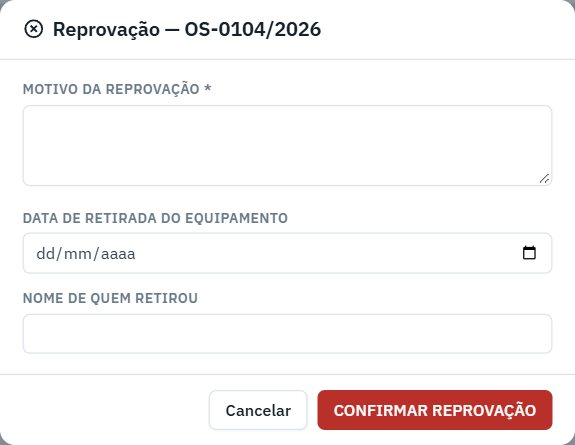

**O que acontece:** a OS fica **Reprovada** (motivo e dados da retirada guardados). **A OS reprovada sai do quadro** e fica **só na lista** (filtro de status "Reprovado"). Uma faixa acima do quadro avisa quantas estão fora.

**Vai para:** **Reprovado**. Para reabrir, use **Reavaliar** (veja abaixo).

### Montar e enviar a cotação (veículo, avaliação remota)

**Quando usar:** a OS de veículo está em **Em Cotação**. Quem age é o SAC.

**Passo a passo:**

1. Clique **Itens** no cartão. Abre a janela **Itens da cotação**.
2. Para cada item, preencha **Código**, **Descrição**, **Qtd** e **Vl. unit. (R$)**. O **Total** soma sozinho. **+ Adicionar linha** acrescenta; o **×** tira a linha.
3. (Opcional) em **Horas cobradas na cotação (h)** coloque as horas de mão de obra que você cobrou. Depois, o sistema **compara com as horas reais** que a Produção apontar (é o KPI que aparece na lista).
4. Clique **Salvar itens**.
5. De volta ao cartão, clique **Enviar Cotação** (botão verde).

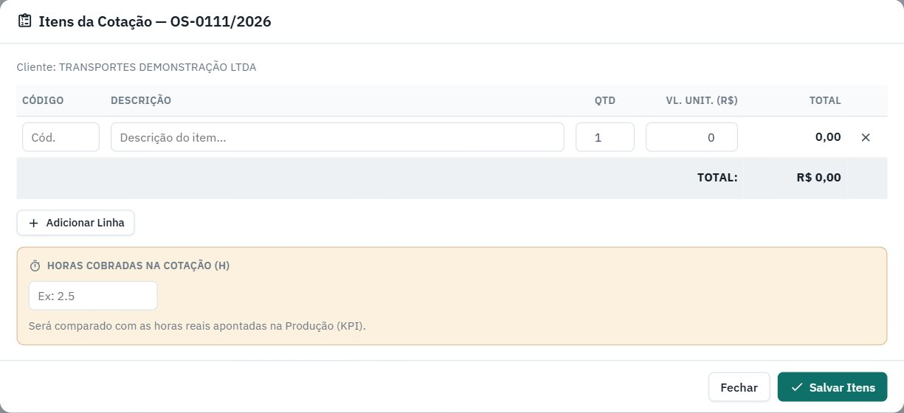

> **Atenção:** **Enviar Cotação** sem itens não funciona: a tela avisa "Adicione os itens antes de enviar!".

**O que acontece:** o **valor da cotação é a soma dos itens**; grava a data de envio; avisa por WhatsApp. Como no orçamento do Laboratório, **o sistema registra, não envia ao cliente**.

**Vai para:** **Aguardando Aprovação Cliente**.

**Registrar a resposta do cliente à cotação:**

- **Aprovado:** o sistema pede o **Nome de quem aprovou\***. Clique **Confirmar aprovação**. A OS vai para **Em Provisionamento** e o WhatsApp avisa a Produção: "definir data de atendimento".

  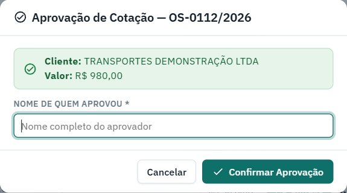

- **Recusado:** o sistema pergunta o **Motivo da recusa (opcional)**. A OS vai para **Reprovado**.

### Orçamento da OS de veículo presencial

**Quando usar:** a OS está em **Aguardando Aprovação Cliente** e o veículo já passou pela verificação: **o orçamento veio da Produção**, com os materiais que ela inseriu.

**Passo a passo:**

1. **Ver Orç.** abre o orçamento só para leitura. **Editar** deixa trocar itens e valores. Ao salvar, o total é recalculado e uma eventual **revisão pendente** é resolvida.
2. Quando o cliente decidir, clique **Aprovado** (o sistema pede confirmação) ou **Recusado**.

**O que acontece:** **Aprovado** grava a aprovação e leva a OS para **Aguardando Início**: a Produção atribui o técnico e inicia. **Recusado** leva a OS para **Reprovado**.

> **Dica:** o botão vermelho **Resolver Revisão (R$ ...)** aparece quando a Produção, durante o serviço, percebe que os itens não batem com o aprovado e **sugere um orçamento revisado**. A OS fica parada até o SAC negociar com o cliente e **resolver**: abre a janela do orçamento com os itens revisados.

### Aceite da data (veículo)

**Quando usar:** a OS está em **Aguardando Aceite SAC**. A Produção marcou a data e o período do atendimento e devolveu ao SAC para **confirmar com o cliente**.

**Passo a passo:**

1. Clique **Aceite SAC**.
2. A janela mostra **"Data definida pela Produção"** (dia da semana, data e período: Manhã, Tarde...).
3. Ligue ou escreva ao cliente e confira se ele aceita.
4. Clique **Cliente confirmou** (se aceitou) ou **Não confirmou** (se não aceitou).

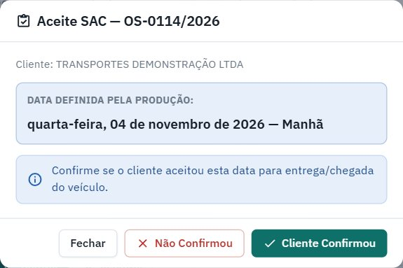

**O que acontece:**

- **Cliente confirmou:** a OS vai para **Aguardando Início** (avaliação remota) ou **Provisionada** (presencial). O WhatsApp avisa "SAC confirmou data".
- **Não confirmou:** o sistema pergunta se tem certeza ("o cliente não aceitou a data e a OS voltará para a Produção redefinir"). Ao confirmar, a OS volta para **Em Provisionamento**, **a data é apagada** e a Produção marca outra.

### Iniciar e concluir a execução (quando o SAC executa)

**Quando usar:** a OS já está **Aprovada** e quem executa é o próprio SAC, ou o Laboratório não registrou o início.

**Iniciar a execução** (menu ⋯ **Mover para Em Execução**):

1. Informe **Quem vai executar\*** e a **Data de início\***.
2. Clique **Confirmar**. A OS passa a **Em Execução**.

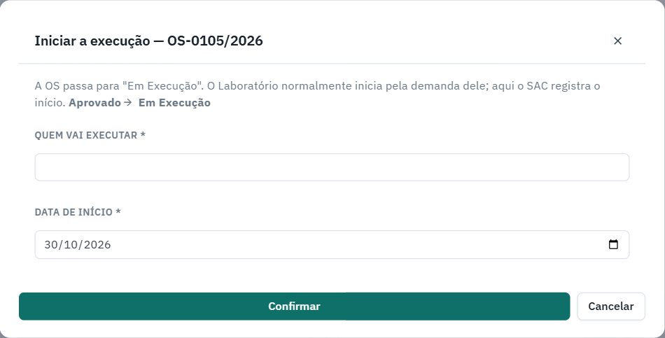

**Concluir a OS:** na OS lançada pelo card do CRM com **"O SAC conclui"**, o botão verde é **Concluir OS**. O sistema pergunta se o serviço foi executado; ao confirmar, a OS vai para **Concluído**. Se outra pessoa já tinha concluído, o sistema avisa e atualiza a lista.

> **Dica:** quando é o **Laboratório** que executa, o cartão mostra um texto cinza: **"Aguardando o Laboratório iniciar"** ou **"Em execução no Laboratório"**. Nada a fazer: o Laboratório inicia e conclui pela demanda dele. Se precisar, o menu ⋯ tem **Mover para ...** como exceção.

### Enviar ao Fiscal (OS do Laboratório, cobrada)

**Quando usar:** a OS está **Concluído** e é **cobrada**. O Fiscal precisa do **valor** e dos **dados da nota**.

**Passo a passo:**

1. Clique **Enviar ao Fiscal** (botão verde).
2. Confira o **Valor total da OS (R$)\***: vem do orçamento aprovado quando existe. É o valor da nota. **Tem de ser maior que zero.**
3. Digite o **CPF ou CNPJ para a nota\*** (**11 dígitos** para CPF, **14** para CNPJ). Pode ser o do cliente ou de outro, se a nota sai em outro nome.
4. (Opcional) **Razão social ou nome na nota** e **Endereço de faturamento**.
5. Clique **Enviar ao Fiscal**.

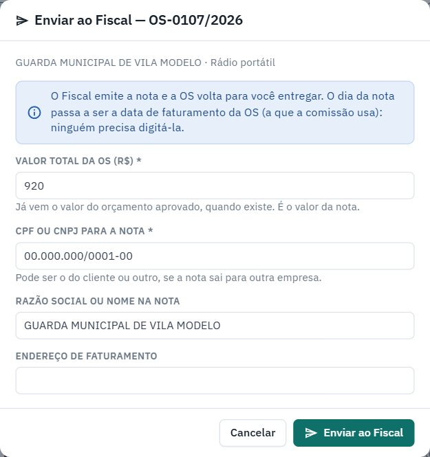

**O que acontece:** a OS vai a **Aguardando Emissão NF** e **o Fiscal passa a vê-la** na tela dele. A **data da nota que o Fiscal emitir vira a data de faturamento da OS** (a que a comissão lê): **ninguém precisa digitá-la**. O tempo do Fiscal passa a contar da data do envio.

**Vai para:** **Aguardando Emissão NF** (quem age: o Fiscal) e, depois da nota, **Faturada - Aguardando Entrega** (quem age: o SAC).

### Enviar ao Fiscal (OS de veículo, cobrada)

**Quando usar:** a Qualidade aprovou o serviço e a OS está em **Aguardando Envio Fiscal**. O Fiscal precisa do **número de série de cada item instalado** para emitir a nota.

**Passo a passo:**

1. Clique **Enviar para Fiscal** (botão verde).
2. A janela lista os itens instalados (descrição e quantidade). Digite o **Nº de série** de cada item.
3. Clique **Enviar para Fiscal**.

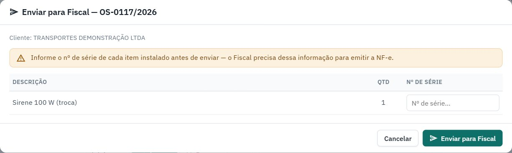

**O que acontece:** os itens com os seriais ficam gravados na OS; a OS vai a **Aguardando Emissão NF**; grava o dia do envio; avisa por WhatsApp. Se outra pessoa já enviou, o sistema avisa e atualiza.

> **Atenção:** o nome do botão é quase igual ao do Laboratório, mas **a janela pede outra coisa** (seriais, não valor e CPF/CNPJ). Está nos pontos de melhoria.

### Entregar ao cliente

**Quando usar:** a OS está **Faturada - Aguardando Entrega**, ou **Concluído** e **sem cobrança**.

**Entrega de OS do Laboratório:**

1. Clique **Entrega**.
2. Digite o **Nome de quem retirou\***.
3. (Opcional) **Fotos de saída**: escolha as imagens do equipamento entregue.
4. Peça a **assinatura de retirada\*** e desenhe no quadro; clique **Confirmar assinatura**.
5. Clique **Confirmar entrega**.

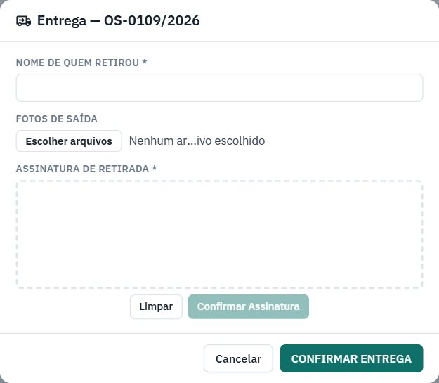

**Entrega do veículo:** a janela é mais simples e pede só o **nome de quem recebeu o veículo\***. Não pede assinatura nem fotos.

**O que acontece:** a OS vai a **Entregue** (o fim do caminho), com a data, o nome e, no Laboratório, a assinatura e as fotos. Avisa por WhatsApp ("OS entregue"). A OS entregue **continua na lista e no quadro**, em **Concluído**.

> **Atenção:** se a assinatura ou uma foto **não subir**, a entrega **não é registrada** e o que você digitou fica na janela para tentar de novo.

### Entregar sem nota (cortesia)

**Quando usar:** a OS está **cobrada** e **Concluído**, mas por decisão do atendimento **não será faturada**.

**Passo a passo:**

1. Menu **⋯ > Entregar sem nota (cortesia)**.
2. Escreva o **motivo** (obrigatório). Clique **Confirmar**.
3. Abre a janela de **Entrega** (a do Laboratório).

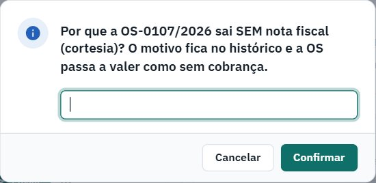

**O que acontece:** a OS **passa a valer como sem cobrança**, o motivo fica no histórico e a OS segue direto para a entrega, **sem passar pelo Fiscal**.

---

## Menu ⋯ (Mais ações da OS)

O menu de três pontinhos tem o que **toda OS** pode fazer. Alguns itens só aparecem quando fazem sentido.

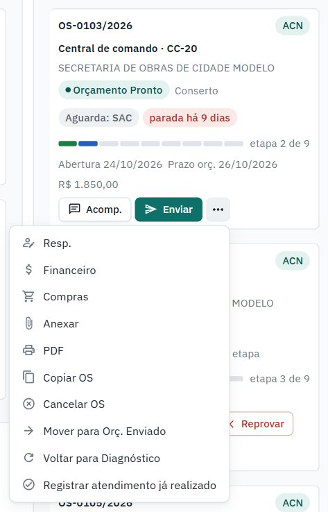

| Item | O que faz | Quando aparece |
|---|---|---|
| **Resp.** | Troca o **responsável da OS** (escolha o novo na lista e **Salvar**) | Enquanto a OS não está Entregue nem Cancelada |
| **Financeiro** | **Valor total** e **Mão de obra** (a comissão lê). Mostra a **data de faturamento**, que vem da nota do Fiscal e **não se digita** | Sempre |
| **Compras** | Lista as compras ligadas à OS e permite **Solicitar compra** ao Compras (fica ligada à OS) | Sempre |
| **Anexar** | Envia arquivos (imagens, PDFs, Word, Excel) para a OS | Sempre |
| **PDF** | Gera a OS em PDF, A4, com campo de **assinatura do cliente** no pé | Sempre |
| **Entregar sem nota (cortesia)** | Veja acima | OS cobrada e Concluído |
| **Copiar OS** | Abre a Nova OS preenchida para criar OS iguais | Sempre |
| **Cancelar OS** | Cancela a OS, com motivo | Antes do Fiscal e se não estiver entregue |
| **Mover para ...** e **Voltar para ...** | Os passos que o SAC pode dar agora | Conforme a etapa (veja *Mover a OS*) |
| **Registrar atendimento já realizado** | Para o serviço feito fora da fábrica | Antes da execução (veja abaixo) |
| **Desfazer o registro do atendimento** | Desfaz o registro acima | OS concluída por esse registro |

### Responsável, Financeiro, Anexar, Compras

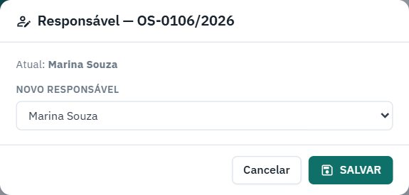

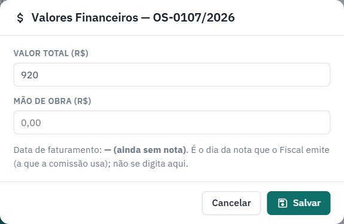

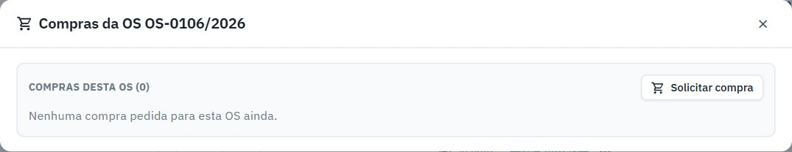

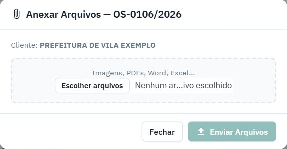

- **Resp.:** o novo responsável fica gravado no histórico de alterações.
- **Financeiro:** só um campo **em branco** vira vazio; um valor **0** que já estava gravado continua 0. Valor e mão de obra mudados ficam no histórico, com o valor de antes.
- **Compras:** mostra "Compras desta OS (N)" com o andamento de cada uma. **Solicitar compra** abre a solicitação **ligada à OS**; no Compras ela aparece com o selo **"Demanda de OS (SAC)"**.
- **Anexar:** escolha os arquivos e clique **Enviar arquivos**. Se algum não subir, **nenhum é anexado** e a escolha fica para você tentar de novo.

### Acompanhamento

O botão **Acomp.** (sempre à vista no cartão) abre a janela **Acompanhamentos** da OS: o caderno do atendimento. Escreva o andamento, uma decisão ou uma pendência no campo **Novo acompanhamento** (use **@Nome** para avisar alguém) e clique **Registrar**. Cada registro mostra quem escreveu e quando.

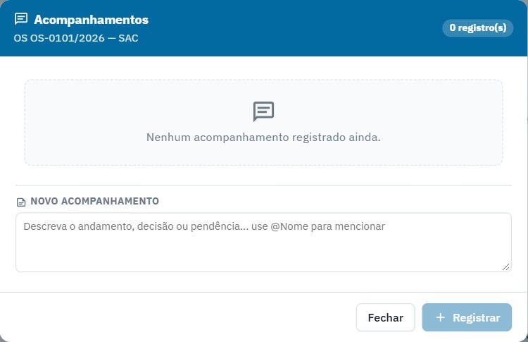

### PDF da OS

O botão **PDF** do menu ⋯ gera a ordem de serviço para imprimir, em **uma folha A4**. No pé vão **ASSINATURA**, **NOME COMPLETO** e **DOCUMENTO**, linhas para o cliente preencher à mão. Numa OS curta sobra um espaço em branco entre o conteúdo e a assinatura, **de propósito**.

---

## Mover a OS entre as etapas

**Quando usar:** a OS precisa avançar ou voltar, e o botão verde do cartão não resolve (por exemplo, o Laboratório esqueceu de iniciar a demanda), ou você quer voltar uma etapa porque registrou algo errado.

**Duas maneiras:**

1. **Arrastar o cartão** para outra coluna do quadro (no computador).
2. **Menu ⋯ > Mover para ... / Voltar para ...** (serve também no celular e no tablet, onde arrastar não funciona).

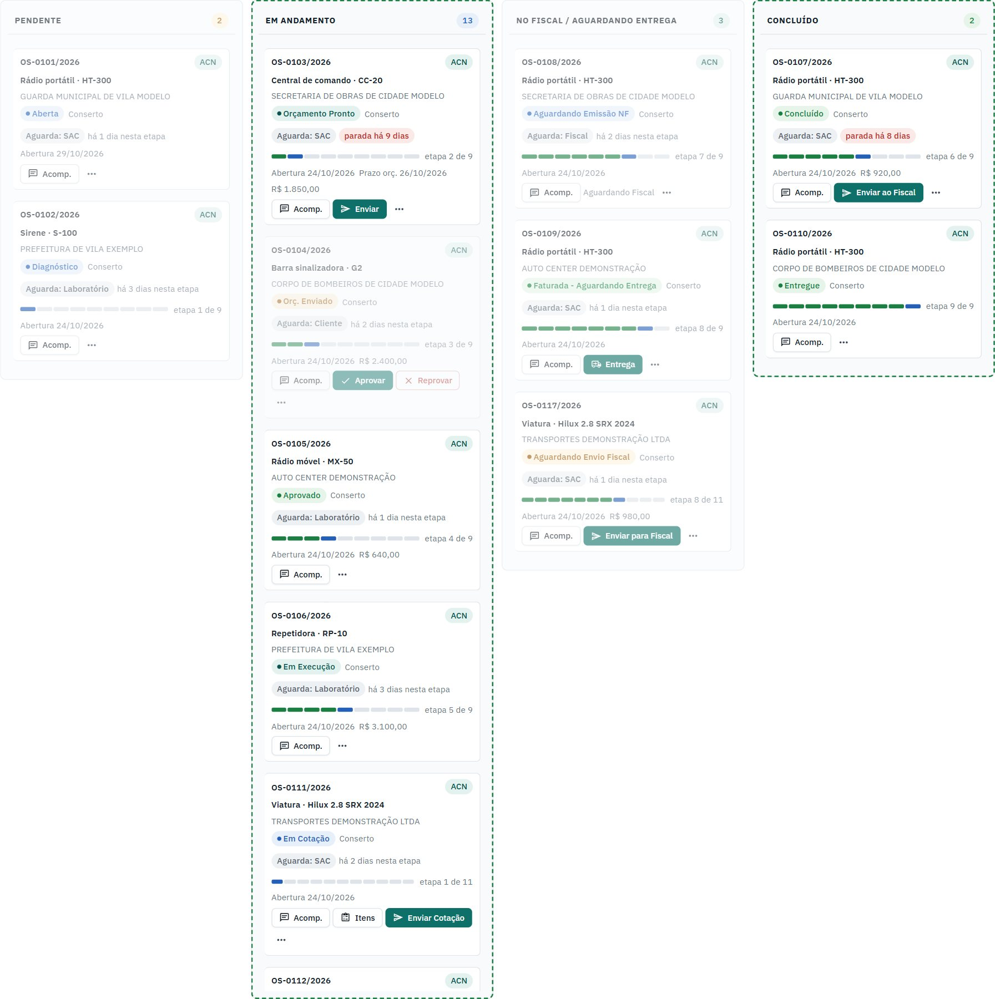

**As regras:**

- O SAC **avança** onde é **ele** quem age e **volta uma etapa**, **sempre com motivo**.
- As etapas da **Produção, da Qualidade (CQ) e do Fiscal** **não se movem por aqui**: nenhum passo entra nelas nem sai delas. É para não pular o CQ nem o Fiscal.
- Se você soltar o cartão **na mesma coluna**, não acontece nada.
- Se soltar numa coluna onde a OS **não pode ir**, a tela diz **por quê**. Se a coluna tem **mais de um passo possível**, abre uma janela para você escolher.

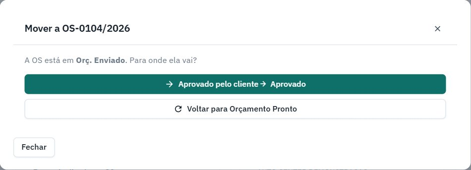

**Os passos, por etapa (o que o SAC pode fazer):**

| Etapa da OS | Passos do SAC |
|---|---|
| **Aberta** | Abrir o diagnóstico (cria a demanda do Laboratório) · Seguir como vendida (vai para a execução, sem cotação) |
| **Diagnóstico** | Informar o orçamento (valor e condições; normalmente o Laboratório faz isso na demanda dele) |
| **Orçamento Pronto** | Enviar o orçamento · Voltar para Diagnóstico |
| **Orç. Enviado** | Aprovado pelo cliente · Reprovado pelo cliente · Voltar para Orçamento Pronto |
| **Aprovado** | Iniciar a execução · Voltar para Orç. Enviado (só se a OS passou pelo orçamento) |
| **Em Execução** (Laboratório) | Concluir a execução / Concluir a OS · Voltar para Aprovado |
| **Concluído** | Enviar ao Fiscal (cobrada) ou Entregar (sem cobrança) · Voltar para Em Execução |
| **Em Cotação** (veículo) | Enviar a cotação · Seguir sem cotação (se for sem cobrança) |
| **Aguardando Aprovação Cliente** | Cotação aprovada / Orçamento aprovado · Cotação recusada · Voltar para Em Cotação (remota) |
| **Aguardando Aceite SAC** | Dar o aceite da data |
| **Aguardando Envio Fiscal** | Enviar ao Fiscal (com os seriais) |
| **Faturada - Aguardando Entrega** | Entregar ao cliente |
| **Reprovado** | Reavaliar |
| **Em Provisionamento, Provisionada, Verificação e Orçamento, Aguardando Início, Aguardando CQ, Aguardando Emissão NF** | **Nenhum** (a OS está com a Produção, a Qualidade ou o Fiscal) |

Em quase toda etapa, antes do Fiscal, também há **Cancelar a OS** e, antes da execução, **Registrar atendimento já realizado**.

**O que acontece ao mover:**

- Os passos que **já tinham janela** (enviar orçamento, aprovar, reprovar, Fiscal, entrega, cotação, aceite, cancelar) **abrem a janela de sempre**.
- Os outros (informar o orçamento, iniciar a execução, concluir, voltar, abrir o diagnóstico, seguir como vendida) **pedem os dados na janela "Mover a OS"** e **não gravam enquanto faltar algo**.
- A gravação **confere a etapa de antes**: se outra pessoa mexeu na OS, o sistema avisa, atualiza a lista e não grava.
- Voltar para antes da aprovação **limpa a marca de "aprovada"**.
- A demanda aberta de outro setor **recebe um recado** no histórico dela; **quem encerra é o setor**.

---

## Registrar atendimento já realizado

**Quando usar:** o serviço **já foi feito fora da fábrica** (no local do cliente, numa oficina parceira, por um técnico em visita) e a OS ficou parada numa etapa de antes da execução. É o caso das OS da Defesa Civil de Taió que estavam em **Em Cotação** com o atendimento já finalizado.

**Quem faz:** o SAC.

**Quando NÃO dá para usar** (o sistema diz o motivo):

- a OS já está **Em Execução**, em **Aguardando CQ** ou além: a fábrica já está com ela ou já a executou;
- a OS é de veículo e **o veículo já chegou à fábrica** (a data de chegada está marcada): o atendimento é da Produção;
- a OS está **encerrada** (**Entregue** ou **Cancelada**) ou **Reprovada** (primeiro **Reavaliar**, depois registre).

**Passo a passo (uma OS):**

1. No cartão da OS, **menu ⋯ > Registrar atendimento já realizado**.
2. A janela mostra a OS que será registrada.
3. Preencha os três campos, **todos obrigatórios**:
   - **Data do atendimento\*:** o dia em que o serviço foi feito (**não pode ser futura**);
   - **Quem fez o atendimento\*:** o nome do técnico ou da empresa;
   - **O que foi feito\*:** descreva o serviço, o local e o que ficou combinado.
4. Clique **Registrar atendimento**.

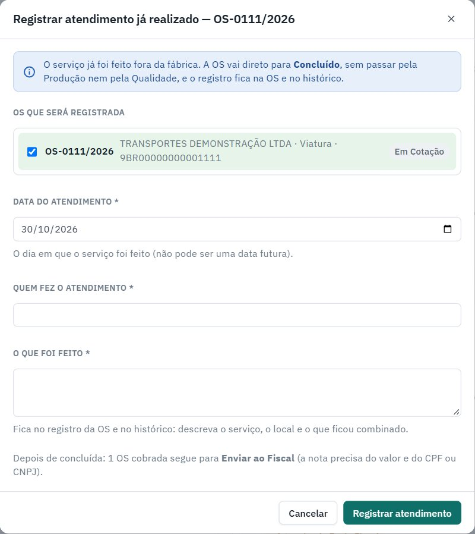

**Passo a passo (várias OS do mesmo lote, de uma vez):**

1. No **cartão do lote**, clique **Registrar atendimento já realizado**.
2. A janela lista **todas as OS do lote que ainda podem ser registradas**, **já marcadas**. Desmarque as que não entram (**Desmarcar todas** limpa a lista).
3. Preencha os três campos (valem para todas).
4. Clique **Registrar N OS**.

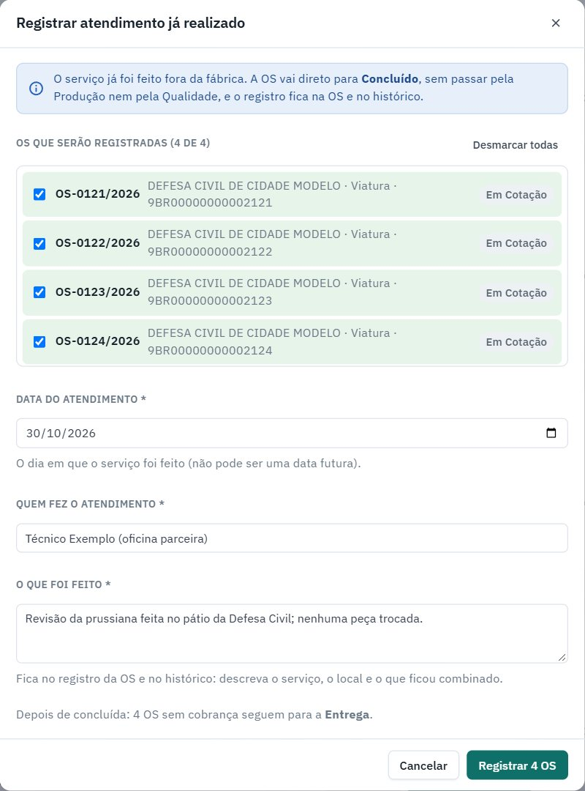

**O que acontece:**

- A OS vai **direto para Concluído**, **sem passar pela Produção nem pela Qualidade**.
- O registro fica na OS (o **resumo** mostra "Feito em", "Quem fez", "O que foi feito", "Registrado por" e "Etapa antes do registro") e no histórico.
- Se havia **demanda aberta** do Laboratório ou da Engenharia, ela recebe um recado ("o SAC registrou o atendimento como já realizado... Encerre esta demanda") e o setor encerra.
- **Não** entra na **comissão da Produção** nem no **KPI de execução**: serviço feito por fora não é produção da fábrica.

**Vai para:** **Concluído**, e daí:

- OS **cobrada**: **Enviar ao Fiscal** (precisa de valor e CPF/CNPJ);
- OS **sem cobrança** (garantia, cortesia): **Entrega**.

> **Dica:** registrou por engano? Na OS concluída por esse registro, o menu ⋯ tem **Desfazer o registro do atendimento**. O sistema pede o motivo, **apaga o registro** e devolve a OS para a **etapa de antes**.

---

## Cancelar uma OS

**Quando usar:** o cliente desistiu, a OS foi aberta em duplicidade ou por engano.

**Quem faz:** quem tem a aba SAC.

**Passo a passo:**

1. Menu **⋯ > Cancelar OS**.
2. Escreva o **motivo** (obrigatório).
3. O sistema mostra o resumo e, se houver **demandas abertas** de outros setores, avisa quais.
4. Confirme.

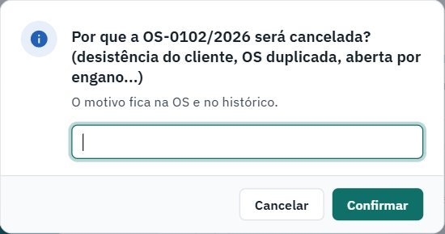

**O que acontece:**

- A OS fica **Cancelada**, com **motivo, data e quem cancelou**.
- A OS **sai do quadro e da lista** (fica só no filtro de status **Cancelada**; uma faixa acima do quadro conta quantas estão fora).
- As demandas abertas dos outros setores **recebem um recado** e o setor é **avisado**: **quem encerra a demanda é o setor**.
- Avisa por WhatsApp, dizendo quais setores devem encerrar a demanda.

> **Atenção:** **não se cancela** a OS que **já está no Fiscal** (Aguardando Emissão NF, Faturada - Aguardando Entrega), a **entregue** nem a **já cancelada**. Se a OS mudou de etapa enquanto você preenchia, o sistema avisa e não cancela.

---

## Reavaliar uma OS reprovada

Na lista (filtro de status **Reprovado**), a OS reprovada tem o botão **Reavaliar**. O sistema pergunta "Reabrir a OS...?". Ao confirmar:

- OS do **Laboratório**: volta para **Diagnóstico**;
- OS de **veículo, avaliação remota**: volta para **Em Cotação**;
- OS de **veículo, avaliação presencial**: volta para **Em Provisionamento**.

A marca de aprovada e o motivo da reprovação são limpos.

---

## Lotes de OS

Quando você abre **várias OS de uma vez** (caixa de lote na Nova OS), o quadro mostra **um cartão de lote**.

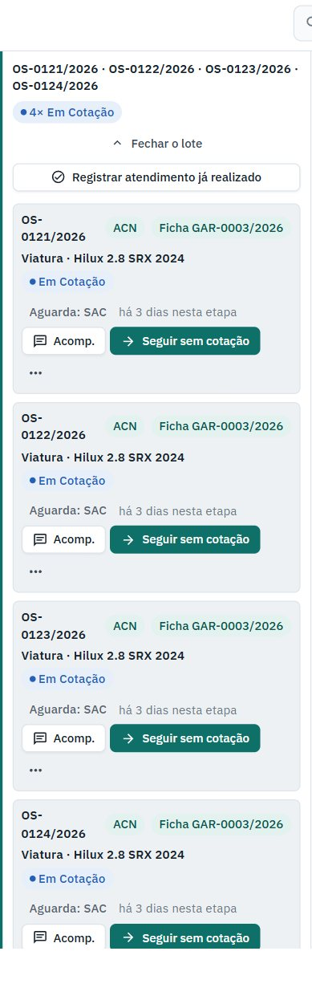

- O cartão mostra **"Lote · N OS"**, o cliente, os **números das OS** e **quantas estão em cada etapa** (por exemplo, "4× Em Cotação").
- **Abrir o lote** mostra cada OS, com o selo da etapa, **quem age**, a barra de progresso e **os mesmos botões** da OS solta.
- **Registrar atendimento já realizado** no cartão do lote registra **várias de uma vez**.
- Para as outras passagens (aprovar, enviar ao Fiscal, entregar), é preciso **abrir o lote e fazer OS por OS**.

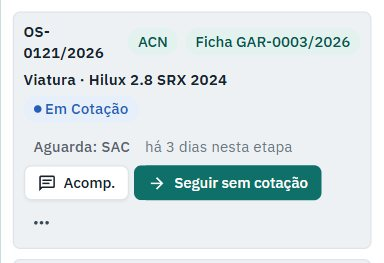

---

## Copiar OS

**Quando usar:** vão chegar **vários equipamentos iguais** do mesmo cliente, ou você quer repetir uma OS que já fez.

**Passo a passo:**

1. Menu **⋯ > Copiar OS**.
2. O sistema pergunta **quantas OS iguais** (de 1 a 20). Ele lista o que leva e o que não leva.
3. A **Nova OS abre preenchida**: uma OS para cada equipamento, cada uma com o seu número.
4. Confira, preencha o **serial** (ou chassi) de cada um e clique **Abrir OS**.

**Leva:** cliente, empresa, tipo de serviço, equipamento ou veículo (marca, modelo), defeito reclamado e observações; prazos, valores, itens da cotação, despesas, dados de faturamento, acompanhamento de engenharia e vínculo com o CRM.

**Não leva:** número de série, chassi, acessórios que vieram junto, fotos e documentos anexados, e **todo o andamento** (etapa, orçamento, aprovação, execução, nota e histórico).

> **Atenção:** a OS de origem com **mais de um equipamento** é copiada **numa OS só**, com a lista inteira, sem serial nem chassi. Para fazer mais de uma cópia, repita o **Copiar OS**.

---

## O painel de leitura da OS (resumo)

Clique **no cartão** (ou na linha) para abrir o **resumo** da OS. Ele mostra, de cima para baixo: **Andamento** (as etapas do caminho, com a atual destacada); **Serviço** (tipo, atendimento, defeito, quem abriu); **Veículo** ou **Equipamento**; **Cliente**; **Andamento** (datas); **Valores**; **Itens da cotação**; **Compras desta OS** (com **Solicitar compra**); **Responsáveis**; e, quando existem, **Atendimento já realizado**, **observações**, **arquivos e fotos**.

---

# Aba Chamados NFC

## Para que serve

O cliente tem, no veículo, uma **etiqueta NFC** (ou um link/QR). Ao encostar o celular, abre a página do veículo e pode **abrir um chamado**: o **botão "Abrir Chamado de Garantia"**. Ele informa o nome, o telefone e descreve o defeito. O chamado **cai nesta aba**, para o SAC atender.

O chamado **não é uma OS**. É um pedido de ajuda. Quando o atendimento mostra que há serviço a fazer, **o SAC abre a OS (ou a ficha de garantia) à mão**.

## A tela

- **Módulo NFC · Chamados de Suporte (NFC):** o título mostra **"N chamado(s) · N aberto(s)"**. O número de abertos é o **total real** de chamados abertos, mesmo quando o filtro mostra outra coisa.
- **Filtro de status:** *Todos os status, Aberto, Em Atendimento, Concluído, Cancelado*. **Ao escolher, a lista já recarrega.**
- **Carregar:** lê a lista de novo (serve para ver chamados que chegaram agora; a aba **não** atualiza sozinha).

Cada chamado é um cartão com:

| O que aparece | O que é |
|---|---|
| **Nome** e **telefone** (com link: no celular, toca para ligar) | Quem abriu o chamado. "Anônimo" se não informou o nome |
| **Selo de status** | **Aberto** (vermelho), **Em Atendimento** (âmbar), **Concluído** (verde), **Cancelado** (cinza) |
| **Chassi · placa · modelo** | O veículo do chamado |
| **Órgão / cliente** | De quem é o veículo |
| **Descrição do defeito** | O que o cliente escreveu (os primeiros 180 caracteres) |
| **Aberto: data e hora · Atendente: nome** | Quando chegou e quem atende |

A borda do cartão tem a cor do status: **vermelha** para o que ainda está **Aberto**.

## Passo a passo: atender um chamado

**Quando usar:** um chamado novo (Aberto) apareceu.

**Quem faz:** o SAC.

1. Abra a aba **Chamados NFC**. Confira o chamado e o telefone.
2. Clique **Atender**. O chamado passa a **Em Atendimento** e **você fica como atendente**.
3. Ligue ao cliente (clique no telefone), entenda o defeito e resolva.
4. Clique **Notas** para registrar o que foi feito (veja abaixo).
5. Terminou? Clique **Concluir**. O chamado passa a **Concluído** e você consta como quem concluiu.

**O que acontece:** o status e o nome do atendente ficam gravados. **A cada Atender ou Concluir o atendente é o último que clicou.**

> **Atenção:** **Salvar apenas as notas não troca o atendente.** Quem editar as notas de um chamado atendido por outra pessoa não passa a constar como atendente.

## Notas de atendimento

O botão **Notas** abre a janela do chamado, com o resumo (quem abriu, telefone, órgão e a descrição do defeito) e o campo **Notas de atendimento**: escreva as ações tomadas ("liguei, o cliente trocou o fusível, orientei a testar"). Clique **Salvar notas**. **Fechar** sai sem salvar.

## O que o chamado vira depois

- **O chamado se resolveu por telefone** (orientação): **Concluir**.
- **Precisa de serviço**: abra uma **OS** (aba Ordens de Serviço > **Nova OS**) ou, se for caso de garantia, uma **ficha** (aba Garantia). **Anote nas Notas** o número da OS ou da ficha para o chamado não ficar solto. O chamado **não** abre a OS sozinho.
- **Não houve atendimento possível** (engano, duplicado): o status **Cancelado** existe no filtro, mas **esta tela não tem botão para cancelar**. Conclua e registre o motivo nas Notas.

> **Dica:** ao abrir a OS a partir do chamado, copie da tela do chamado o **chassi, a placa e o modelo**: eles já estão lá.

---

# Aba Garantia

## Para que serve

A **ficha de garantia** é o **prontuário** de um atendimento em garantia: do relato do cliente até o fim, **guarda tudo num lugar só**: a avaliação técnica, a consulta ao fornecedor, os custos, a conversa com o cliente, a autorização da direção, as peças que vão e voltam, o diário técnico e a OS de execução.

> **Regra de ouro:** **toda OS de garantia nasce de uma ficha.** Sem a ficha, a Nova OS de garantia não abre.

## Quem faz o quê

| Quem | O que pode |
|---|---|
| **Abrir** a ficha | Admin, qualquer gerente, o Comercial, o SAC e quem tem a aba SAC liberada |
| **Ver** a ficha | Quem abriu, o **responsável**, os **copiados** e o Admin |
| **Editar, cancelar e reabrir** | Quem abriu, o responsável e a gerência |
| **Conduzir** (avaliação, fornecedor, custos, alinhamento, pedir autorização, quem executa, peças, apontamentos, encerrar) | O **responsável** pelo atendimento e a gerência |
| **Decidir a autorização** | **Só a direção** (perfil Admin) |
| **Ver o relatório semanal** | A gerência e o Admin |

## A lista

- **Atendimentos em garantia (N):** o título.
- **Abertos / Encerrados / Cancelados / Todos:** os filtros, com a contagem de cada um. O padrão é **Abertos**.
- **Busca:** por **número, cliente, placa, OP...**
- **Colunas:** Número (GAR-0001/2026), Cliente, Veículo, Placa/Chassi, Origem, Falha, Ocorrência, Responsável, **Etapa** e **Situação**.
- **Selo "Parado há N d" (âmbar):** o atendimento **aberto** e **sem nenhum movimento na ficha há 5 dias ou mais**. É o alerta para não deixar o cliente esperando.
- Clique numa linha para **abrir a ficha**.

## Abrir um atendimento (nova ficha)

**Quando usar:** o cliente relatou uma falha num produto vendido (ainda em garantia ou não: **a ficha é aberta de qualquer jeito**; quem diz se está na garantia é a avaliação técnica).

**Passo a passo:**

1. Aba **Garantia** > **Novo atendimento**.
2. Preencha (tudo com **\*** é obrigatório):
   - **Cliente\*** e **Contato do cliente (telefone ou e-mail)\***;
   - **Veículo (catálogo)\***: procure por marca, modelo ou ano. Se não existir, **+ Novo** cadastra;
   - **Placa** ou **Chassi**: **ao menos um dos dois**. A placa é conferida (formato ABC1234 ou ABC1D23); o chassi tem 17 letras e números, sem I, O e Q. O sistema tira espaços e traços e deixa em maiúscula;
   - **Origem da venda\***: **OP**, **OS do SAC** ou **Nota fiscal da venda**. Para OP e OS, **digite o número e escolha na lista**; para nota fiscal, digite o número. Escolher a **OS** de origem já preenche cliente, contato e chassi (só o que está em branco);
   - **Descrição da falha\***: o que o cliente relata, quando começou, o que já foi tentado;
   - **Data da ocorrência\***: o dia da falha (**não pode ser futura**);
   - **Responsável pelo atendimento\***: vem você; troque se for outra pessoa;
   - **Quem é copiado\***: **ao menos uma pessoa**. Quem é copiado **recebe os avisos** do atendimento (**Selecionar todos** coloca todos).
3. Clique **Abrir atendimento**.

**O que acontece:**

- O **banco dá o número** (**GAR-0001/2026**, sequencial por ano, sem pular nem repetir).
- Você entra como **autor**. A abertura **avisa** o responsável e os copiados (na caixa de **Menções**, o sino).
- A janela fica aberta? Se faltar algo, ela diz **o que falta**, em português.

> **Atenção:** a janela **não fecha ao clicar fora**: um clique solto não perde o que você digitou. Para sair, **Cancelar**.

## A ficha por dentro

Ao clicar numa linha, abre a **ficha**. No alto: o **número**, a **etapa** e a **situação**, e os dados do atendimento (cliente, contato, veículo, placa, chassi, origem, data da ocorrência, responsável, quem abriu, descrição da falha e **copiados**).

Abaixo vêm as **seções**. **Cada seção tem um selo** que mostra a situação dela. A ficha caminha em **quatro etapas**:

FLUXO: Avaliação técnica > Fornecedor > Quem executa > Em atendimento

**Regra da ficha: "sem avaliação, não segue".** O fornecedor e quem executa só se registram **depois** da avaliação técnica.

### 1. Projeto de origem (Desenvolvimento)

Mostra se o **veículo** tem projeto no Desenvolvimento da Engenharia. Quando tem, aparece o que a Engenharia deixou para a Garantia e o botão para **pedir uma mudança no projeto** (o pedido vai para o projeto, **ligado a esta ficha**). Se o veículo não tem projeto: *"Nenhum projeto do Desenvolvimento ligado a este veículo."*

### 2. Avaliação técnica

**Quando usar:** logo depois de abrir a ficha. **Quem faz:** o responsável ou a gerência.

1. Clique **Registrar avaliação**.
2. Escreva o **Parecer técnico\***: o que foi encontrado, a causa provável e o que precisa ser feito.
3. Escolha a **Cobertura\***: **Dentro da garantia**, **Fora da garantia** ou **A confirmar**.
4. Clique **Registrar avaliação**.

**Apoio do sistema:** se a origem é uma OP com garantia e data de entrega, a ficha mostra, por exemplo: *"garantia da OP de 12 meses, entregue em 13/04/2026, termina em 13/04/2027. A falha foi em 19/10/2026: dentro do prazo (faltavam 176 dias)"*. **É só apoio**: quem decide é o técnico.

**O que acontece:** a etapa passa a **Fornecedor**. **Refazer a avaliação** troca o parecer (o histórico anota "avaliação refeita").

- **Dentro da garantia:** segue normalmente.
- **A confirmar:** não trava, mas a ficha avisa: *"Se ficar fora da garantia, será preciso o alinhamento com o cliente e a autorização da direção para seguir."*
- **Fora da garantia:** **trava** quem executa e o pedido de peça até haver **alinhamento aceito pelo cliente** **e** **autorização aprovada pela direção** (veja abaixo). Uma faixa amarela no alto da ficha diz o que falta.

### 3. Fornecedor (garantia da peça)

**Quando usar:** depois da avaliação. O defeito pode estar numa peça que **o fornecedor cobre**: a ficha guarda a consulta.

**Opção A, consultar o fornecedor:**

1. Clique **Registrar consulta ao fornecedor**. Em **O que registrar**, deixe **Consulta ao fornecedor**.
2. Preencha **Fornecedor\***, **Protocolo**, **Data da consulta\*** (não pode ser futura) e **Prazo de resposta**.
3. Se o fornecedor **já respondeu**, escreva a **Resposta do fornecedor**. Aparecem **O fornecedor...\*** (**cobre**, **cobre em parte** ou **não cobre**) e a **Data da resposta\***. Se **ainda não respondeu**, deixe a resposta em branco.
4. Clique **Registrar**.

Depois, quando o fornecedor responder, o botão vira **Registrar a resposta**.

**Opção B, "Não se aplica":** em **O que registrar**, escolha **Não se aplica (justifique)** e escreva **por que a consulta não se aplica\***. Clique **Registrar**.

**O selo da seção** mostra: **Não registrado**, **Aguardando resposta**, **Resposta atrasada há N dias** (vermelho, quando passou o prazo de resposta), **O fornecedor cobre / Cobre em parte / Não cobre**, ou **Não se aplica**.

**O que acontece:** a etapa só passa a **Quem executa** quando a consulta está **respondida** ou **dispensada com justificativa**.

### 4. Quadro de custos

**Quando usar:** sempre que souber de uma despesa do atendimento.

1. Clique **Lançar custos** (na seção vazia) ou **Editar o quadro** (quando já há linhas).
2. Para cada linha (**Adicionar custo** acrescenta uma; o **×** tira):
   - **Tipo**: Diagnóstico, Deslocamento, Frete, Mão de obra, Peça, Terceiro ou Outro;
   - **Descrição** (opcional);
   - **Previsto R$\***;
   - **Negociado R$** (o valor que se conseguiu negociar; **em branco, vale o previsto**) e **Quem negociou** (**obrigatório se houver valor negociado**);
   - **Paga:** **Nós (empresa)**, **Cliente** ou **Fornecedor**;
   - **Aprovado:** marque quando o valor for aprovado (fica gravado **quem aprovou e quando**).
3. Clique **Salvar quadro de custos**.

**Os totais** que o quadro mostra: **Previsto**, **Considerado** (o **negociado**, quando houver; senão o previsto), **Aprovado** e **quanto cada um paga** (empresa, cliente, fornecedor). Aceita até **40 linhas**. Cada alteração fica no histórico, dizendo **o que entrou e o que saiu**.

> **Dica:** se a execução for por **terceiro** com custo previsto, aparece o botão **Lançar o custo do terceiro (R$ ...)**, que põe esse custo no quadro com um clique. Só dá para lançar **uma vez**.

### 5. Alinhamento com o cliente

**Quando usar:** quando você conversa com o cliente sobre o atendimento, **principalmente se estiver fora da garantia**.

1. Clique **Registrar alinhamento**.
2. Preencha **Com quem do cliente falou\***, **Dia da conversa\*** (não pode ser futuro), **Por onde\*** (Telefone, WhatsApp, E-mail, Presencial, Outro), **O cliente...\***: **aceitou**, **não aceitou** ou **aguardando o cliente**, e **O que ficou combinado (condições e quem paga)\***.
3. Clique **Registrar alinhamento**.

**O que acontece:** **cada conversa fica guardada** (só se acrescenta); **vale a última** para as travas. Só **"O cliente aceitou"** libera o atendimento fora da garantia.

### 6. Autorização da direção

**Quando usar:** despesa **fora da garantia** ou **cortesia**. **Tudo isso vai para a direção, sem faixa de valor.**

**Quem pede (o responsável ou a gerência):**

1. Clique **Pedir autorização à direção**.
2. Em **O que está sendo pedido\***, escolha **Despesa fora da garantia** ou **Cortesia**. Em **Valor (R$)\*** já vem o que a **empresa paga** no quadro de custos. Escreva o **Motivo\***.
3. Clique **Pedir à direção**. **Só pode haver um pedido esperando por vez.**

**Quem decide (só o Admin):**

- **Aprovar** (o sistema pergunta "Autorizar ... de R$ ...?") ou **Negar** (pergunta "Por que a autorização foi negada?": o motivo é **obrigatório**).

Quem pediu, o responsável e a gerência ainda podem usar **Cancelar o pedido** enquanto ele espera a direção (com motivo).

**O que acontece:** o pedido **avisa toda a direção** (todos os Admin) na caixa de Menções. A decisão **avisa** o responsável e os copiados. Fica gravado **quem decidiu e quando**.

### 7. Quem executa

**Quando usar:** com a avaliação e o fornecedor resolvidos (e, se fora da garantia, o alinhamento aceito e a autorização aprovada).

1. Clique **Definir quem executa**.
2. Em **Quem executa\***, escolha:
   - **Equipe própria:** escolha cada técnico na lista e clique **Adicionar técnico** (pelo menos um; o **×** tira);
   - **Terceiro:** digite o **Terceiro (empresa ou pessoa)\*** e o **Custo previsto (R$)** (pode ficar para depois).
3. Clique **Registrar**.

**O que acontece:** a etapa passa a **Em atendimento**. **Alterar** troca a escolha.

### 8. Ordens de serviço

**Quando usar:** a execução vai ser feita pela fábrica (Laboratório ou Produção) e **precisa de uma OS**.

1. Clique **Gerar OS de execução**.
2. A **Nova OS** abre **já preenchida** com cliente, contato, veículo, chassi e falha, **ligada a esta ficha**.
3. Em **Esta OS será**, escolha **Sem cobrança (garantia ou cortesia)** ou **Cobrada do cliente** (a sugestão vem da cobertura da ficha). Termine como qualquer OS (veja a Parte 2).

> **Atenção:** o botão só libera com a **avaliação técnica registrada**; se a cobertura é **fora da garantia**, falta o **alinhamento aceito** e a **autorização**. Quando não libera, o botão vira uma frase dizendo o que falta ("Para gerar a OS: ..."). E o botão só existe para quem tem a **aba SAC**.

**O que acontece:** a seção mostra **a lista das OS geradas**, com a **etapa de cada uma** e se é **sem cobrança** ou **cobrada**. O histórico da ficha registra "Ordem de serviço gerada: OS-0130/2026 (sem cobrança)". Na OS, o selo **Ficha GAR-...** leva de volta à ficha com um clique.

### 9. Peças pedidas ao Compras (reposição)

**Quando usar:** é preciso **comprar** uma peça para repor.

1. Clique **Pedir peça ao Compras**.
2. A solicitação abre **com o título "Peça em garantia — GAR-0001/2026"** e o contexto da ficha (cliente, veículo, fornecedor consultado). Preencha como qualquer solicitação de compra e envie.
3. O pedido **fica ligado à ficha**, com o número do pedido (**PC-0150/2026**).

> **Atenção:** o botão **fica desligado** até haver a **avaliação técnica** e a **consulta ao fornecedor respondida** (ou justificada). Quando está desligado, a frase embaixo diz o que falta. Se a ficha for **fora da garantia**, também exige alinhamento e autorização.

> **Dica:** se o pedido **nasceu no Compras mas a ficha não gravou**, o sistema avisa o **número do pedido**: **não abra outro**, avise a gerência para ligar o pedido ao atendimento.

### 10. Peças em garantia (envio e retorno)

**Quando usar:** a **peça defeituosa** vai ao fornecedor para análise ou troca, e depois **volta** (ou é reposta ou descartada). É diferente do "Pedir peça ao Compras": aqui você acompanha **a peça que saiu**.

**Cadastrar a peça:**

1. Clique **Cadastrar peça em garantia**.
2. Informe a **Peça\*** (por exemplo, "fonte 12V da barra"), a **Quantidade\*** (inteiro, 1 ou mais) e o **Número de série**.
3. Clique **Cadastrar peça**. A peça entra como **A enviar**.

**Registrar cada passo da peça** (botão **Registrar movimento**, dentro da peça): ela segue **um caminho**:

FLUXO: A enviar > Enviada ao fornecedor > Em análise > Retornou / Reposta / Descartada

| De | Pode ir para |
|---|---|
| **A enviar** | Enviada ao fornecedor · Descartada |
| **Enviada ao fornecedor** | Em análise · Retornou · Reposta · Descartada |
| **Em análise** | Retornou · Reposta · Descartada |
| **Retornou, Reposta, Descartada** | (fim do caminho) |

4. Em cada movimento informe **Agora a peça está\*** (só aparecem as situações possíveis), a **Data\*** (não pode ser futura nem antes do movimento anterior), o **Rastreio** (código ou transportadora) e a **Observação**. Para **Descartada**, o campo vira **Por que foi descartada\*** e é obrigatório. Clique **Registrar movimento**.
5. A **Trilha da peça (N)** mostra, do mais novo ao mais antigo, cada movimento com data e quem registrou.

**Errou?**

- **Desfazer o último movimento:** aparece quando a peça já teve movimento; volta um passo (nunca o primeiro) e **pede o motivo**, que fica no histórico.
- **Tirar a peça:** aparece só enquanto a peça **nunca saiu do começo** (cadastrada por engano). Se já tem movimento, desfaça os movimentos antes.

A seção mostra o selo **"N ainda não voltou"** para as peças que ainda não chegaram a um fim, e o aviso de **dias parada**; a partir de **5 dias** vira atenção.

### 11. Apontamentos do atendimento (diário técnico)

**Quando usar:** a cada dia de trabalho no atendimento.

1. Clique **Registrar apontamento** (ou **Editar os apontamentos**, quando já há).
2. Para cada linha (**Adicionar apontamento** acrescenta uma; o **×** tira): **Dia** (não pode ser futuro), **Técnico** (escolha na lista de colaboradores), **Horas\*** (de 0 a 24), **Falha encontrada\***, **Solução adotada** (pode ficar para depois) e **Peças aplicadas** (opcional).
3. Clique **Salvar apontamentos**.

**O que acontece:** a seção mostra o **total de horas** (e por técnico). Aceita até **200 apontamentos**. **Para encerrar o atendimento é preciso ao menos um apontamento com a solução adotada.**

### 12. Histórico do atendimento

A lista de **tudo que aconteceu na ficha**, com **data, hora e quem fez** (abertura, avaliação, fornecedor, execução, custos, alinhamento, autorização, peças, apontamentos, OS gerada, edição, cancelamento, reabertura, encerramento). Não se apaga nada: **a ficha só acrescenta**.

## O rodapé da ficha

| Botão | O que faz | Quem |
|---|---|---|
| **Editar** | Abre a mesma janela da abertura (cliente, veículo, origem, falha, responsável, copiados); o botão final é **Salvar alterações**. **Só com a ficha aberta.** O histórico diz **quais campos mudaram**; se nada mudou, o sistema avisa "Nada foi alterado" | Quem abriu, o responsável, a gerência |
| **Cancelar atendimento** (vermelho) | Pede o **motivo** (obrigatório) e uma confirmação. **Nada é apagado** | Quem abriu, o responsável, a gerência |
| **Reabrir** | Pede confirmação e reabre a ficha **cancelada** ou **encerrada** | Cancelada: quem abriu, o responsável, a gerência. Encerrada: o responsável e a gerência |
| **Encerrar atendimento** | Pede o **texto de fechamento** ("o que foi feito e como o atendimento terminou") e uma confirmação. Depois de encerrado, **não recebe mais registros** (dá para reabrir) | O responsável e a gerência |
| **Fechar** | Fecha a janela da ficha | Todos |

**Para o botão Encerrar liberar** a ficha precisa ter:

1. a **avaliação técnica** registrada;
2. **nenhuma peça em garantia que ainda não voltou** (todas **Retornou, Reposta ou Descartada**);
3. **nenhum pedido de autorização esperando** a direção (decida ou cancele);
4. **ao menos um apontamento com a solução adotada**.

Enquanto faltar algo, o botão fica desligado e a frase ao lado diz **o que falta** ("Para encerrar falta: dar fim a 1 peça em garantia que ainda não voltou...").

> **Atenção:** a ficha **nunca se apaga**. Para desfazer algo, use **Cancelar** (com motivo) e, se precisar, **Reabrir**.

**Faixas no topo da ficha** (leia antes de mexer): **verde**, "Atendimento encerrado por ... em ... " com o texto de fechamento; **âmbar**, "Atendimento parado: sem nenhum movimento na ficha há N dias" (com o último movimento); **âmbar**, "Atendimento cancelado. Motivo: ... Nada foi apagado".

## Quem é avisado, e quando

**Todo evento novo do histórico da ficha avisa** o **responsável** e os **copiados** (**quem fez a ação não é avisado**), na caixa de **Menções** (o sino). O aviso **leva direto à ficha**.

- **Sempre avisam:** abertura, cancelamento, reabertura, **pedido de autorização** (e aí **toda a direção**, ou seja, **todos os Admin**) e a **decisão da direção**.
- **Também avisam:** avaliação, fornecedor, quem executa, peça pedida ao Compras, alinhamento, quadro de custos, cada movimento de peça, apontamentos e OS gerada.
- Quem **entra ou sai** do atendimento numa edição (responsável ou copiados) **é avisado** com uma frase dizendo o que mudou para ele.

## O relatório semanal

**Quando usar:** a gerência e o Admin fazem a reunião semanal da garantia.

**Passo a passo:** na lista da aba Garantia, clique **Relatório semanal** (só aparece para a gerência e o Admin).

- **Semana anterior / Semana seguinte / Esta semana / data:** escolhem a semana. **Semana é de segunda a domingo.**
- **Cartões do resumo:** *Abertos na semana, Encerrados na semana, Cancelados na semana, **Em aberto hoje**, **Parados há 5 dias ou mais**, **Peças que não voltaram**, **Esperando a direção**, Horas apontadas na semana, Custo considerado (movimentados).*
- **Tabelas:** *Atendimentos movimentados na semana* (com custo considerado, pago pela empresa e horas), *Encerrados na semana* (com o texto de fechamento), *Parados há 5 dias ou mais*, *Peças em garantia que ainda não voltaram* e *Esperando a decisão da direção*.
- **Baixar PDF:** gera o mesmo relatório para imprimir ou enviar.

> **Atenção:** o que depende da semana escolhida (abertos, encerrados, movimentados, horas) usa **os dias da semana**. O que é **"agora"** (em aberto, parados, peças que não voltaram, esperando a direção) é **sempre a situação de hoje**, qualquer que seja a semana: a ficha só guarda o último estado, então não dá para reconstruir o que estava parado numa semana antiga. O relatório avisa isso na tela.

---

# Aba Cadastros

## Para que serve

Os **Cadastros** são as **listas** que aparecem nas escolhas da **Nova OS**. Se um tipo de equipamento, uma categoria ou um tipo de serviço **não está aqui**, **não aparece** na Nova OS.

Há **três listas**, nas abas internas: **Equipamentos**, **Categorias (Tipo Projeto)** e **Tipos de Serviço**.

> **Atenção:** nada se **apaga**: você **desativa** (o item some da Nova OS) e pode **Ativar** de novo. As OS antigas **não mudam**: guardam o texto que tinham.

## Equipamentos

**Para que serve:** a lista do campo **Tipo de equipamento** da Nova OS.

**Passo a passo:**

1. Aba **Cadastros > Equipamentos**.
2. Digite o nome em **"Nome do tipo de equipamento..."** e clique **Adicionar**.
3. Para tirar um tipo da Nova OS, clique **Desativar** (vermelho). O tipo fica **cinza**, marcado **Inativo**, com o botão **Ativar**.

> **Dica:** na própria Nova OS, o link **+ novo**, ao lado de **Tipo de equipamento**, cadastra um tipo na hora (sem sair da janela).

## Categorias (Tipo Projeto)

**Para que serve:** a lista do campo **Categoria (tipo projeto)** da Nova OS. A categoria também **muda o que a Nova OS pede**.

**Passo a passo:**

1. Aba **Cadastros > Categorias (Tipo Projeto)**.
2. Digite o **Nome da categoria**.
3. Se esta categoria tem **gastos de campo**, marque **"Exibe despesas de campo (Serviço Externo)"**: a Nova OS passa a pedir **Deslocamento, Hospedagem e Alimentação**.
4. Clique **Adicionar**.
5. **Editar** troca o nome e a marca de despesas. **Desativar / Ativar** liga e desliga.

> **Atenção:** o sistema **reconhece a OS de veículo pelo nome da categoria**: nomes que têm "manutenção" (ou "garantia") **e** "veicular" (ou "veículo") levam a OS para o **caminho do veículo**. **Não renomeie** a categoria **Manutenção Veicular** nem crie outra com nome parecido sem avisar a TI.

## Tipos de Serviço

**Para que serve:** a lista do campo **Tipo de serviço** da Nova OS. Hoje: **Orçamento, Conserto, Troca e Garantia**.

**Passo a passo:**

1. Aba **Cadastros > Tipos de Serviço**.
2. Digite o nome em **"Nome do tipo de serviço..."** e clique **Adicionar**.
3. **Desativar / Ativar** liga e desliga.

> **Atenção:** o tipo **Garantia** é **especial**: o sistema reconhece a OS de garantia **por esse nome** (a ficha, a OS sem cobrança, tudo depende dele). **Não desative nem renomeie o tipo "Garantia"**: se desativar, **a garantia deixa de abrir OS**. A tela hoje **não protege** esse botão: está nos pontos de melhoria.

> **Atenção:** quando uma lista está **vazia**, a tela mostra uma mensagem técnica ("Rode o SQL ... no Supabase"). Se você a vir, **avise a TI**: significa que o cadastro não foi montado. A lista de tipos de serviço tem uma reserva (Orçamento, Conserto, Troca, Garantia) que aparece sozinha.

---

# Dúvidas do dia a dia

## "O que fazer quando..."

| Situação | O que fazer |
|---|---|
| **O serviço já foi feito fora da fábrica, mas a OS está em Em Cotação** (ou em outra etapa antes da execução) | Menu ⋯ da OS > **Registrar atendimento já realizado**. Para um lote, use o botão **Registrar atendimento já realizado** do cartão do lote. A OS vai para **Concluído** |
| **Registrei o atendimento por engano** | Na OS concluída por esse registro, menu ⋯ > **Desfazer o registro do atendimento** (pede o motivo) |
| **A OS é garantia, mas apareceu em "Em Cotação"** | OS antiga: botão **Seguir sem cotação** (uma por vez). OS nova de garantia nasce sem cotação |
| **Preciso abrir uma OS de garantia** | Primeiro a **ficha** (aba Garantia). Depois **Gerar OS de execução** na ficha |
| **O cliente aprovou, mas a assinatura não subiu** | A aprovação **não foi registrada**. A janela fica aberta com o que você digitou: tente de novo (confira a conexão) |
| **A OS "sumiu" da lista** | Confira os **filtros** (botão **Limpar**) e a faixa acima do quadro: OS **Reprovada** e **Cancelada** ficam fora do quadro e só aparecem na lista, pelo filtro de status |
| **A OS está parada em outra etapa** | O cartão diz **"Aguarda: ..."** e **"parada há N dias"**. Use **Acomp.** para registrar a cobrança e **@Nome** para avisar o setor |
| **A OS está num setor e eu preciso adiantar** | Se é do **Laboratório**, o menu ⋯ tem **Mover para ...**. Se está com **Produção, Qualidade ou Fiscal**, o SAC **não move**: peça ao setor |
| **Abri a OS por engano ou o cliente desistiu** | Menu ⋯ > **Cancelar OS** (com motivo). Se já está no Fiscal, o cancelamento passa pelo Fiscal |
| **O cliente quer a OS sem cobrança, e ela já está concluída** | Menu ⋯ > **Entregar sem nota (cortesia)** (com motivo) |
| **Chegaram vários equipamentos iguais** | Na **Nova OS**, aumente a **Qtd** e marque a caixa do lote. Para repetir uma OS existente: **Copiar OS** |
| **Preciso do PDF para o cliente assinar** | Menu ⋯ > **PDF**. A assinatura do cliente fica no pé da folha |
| **Duas pessoas mexeram na mesma OS** | O sistema avisa **"a OS já mudou de etapa (outra pessoa mexeu nela)"** e atualiza a lista. Confira e refaça se for o caso |
| **Chamado NFC de cliente** | Aba **Chamados NFC** > **Atender** > **Notas** > **Concluir**. Se há serviço, abra a **OS** ou a **ficha** |

## O que o sistema avisa por WhatsApp

Se o aviso estiver **ligado na configuração do sistema**, o grupo configurado recebe uma mensagem a cada um destes passos:

| Passo | Mensagem |
|---|---|
| Nova OS | "Nova OS ..., cliente, equipamento, tipo, por quem" (no lote, **um aviso** com todos os números) |
| Orçamento enviado | "Orçamento enviado — OS ..., cliente, valor" |
| Cotação enviada | "Cotação enviada — OS ..., cliente, total" |
| Cotação aprovada | "Cotação APROVADA ... Produção: definir data de atendimento" |
| OS aprovada | "OS ... APROVADA, cliente, aprovador" |
| OS reprovada | "OS ... REPROVADA, cliente, motivo" |
| Aceite da data | "SAC confirmou data — OS ..., data e período" |
| Enviado ao Fiscal | "Enviado para o Fiscal — OS ..." |
| OS entregue | "OS ... ENTREGUE, cliente, retirado por" |
| OS cancelada | "OS ... CANCELADA, motivo, setores que devem encerrar a demanda" |

## Todas as etapas e quem age

| Etapa | Quem age | O que fazer |
|---|---|---|
| **Aberta** | SAC | OS sem caminho: decidir se segue, cancela ou cobra |
| **Diagnóstico** | Laboratório (veículo: Produção) | Terminar o diagnóstico e o orçamento |
| **Orçamento Pronto** | **SAC** | Enviar o orçamento ao cliente |
| **Orç. Enviado** | Cliente | Resposta ao orçamento (o SAC cobra) |
| **Aprovado** | Laboratório | Iniciar a execução |
| **Em Cotação** | **SAC** | Montar e enviar a cotação (garantia: seguir sem cotação) |
| **Aguardando Aprovação Cliente** | Cliente | Aprovação da cotação ou do orçamento (o SAC cobra e registra) |
| **Em Provisionamento** | Produção | Marcar a data do atendimento |
| **Aguardando Aceite SAC** | **SAC** | Confirmar a data com o cliente |
| **Provisionada / Aguardando Início** | Produção | Receber o veículo e iniciar |
| **Verificação e Orçamento** | Produção | Verificar o veículo e orçar |
| **Em Execução** | Laboratório ou Produção (ou o SAC, na OS lançada pelo card com "O SAC conclui") | Executar o serviço |
| **Aguardando CQ** | Qualidade | Auditar a OS |
| **Concluído** | **SAC** | Enviar ao Fiscal (cobrada) ou Entregar (sem cobrança) |
| **Aguardando Envio Fiscal** | **SAC** | Informar os seriais e enviar ao Fiscal |
| **Aguardando Emissão NF** | Fiscal | Emitir a nota |
| **Faturada - Aguardando Entrega** | **SAC** | Entregar ao cliente |
| **Entregue** | ninguém | Fim do caminho |
| **Reprovado** | **SAC** | Reavaliar ou encerrar a OS |
| **Cancelada** | ninguém | Fim do caminho |

## Quando algo dá errado

- **"Não foi possível gravar" / "A OS NÃO foi aberta":** o texto diz **o que não foi gravado**. Nada pela metade: a janela continua aberta com o que você digitou. Tente de novo.
- **"A OS já mudou de etapa (outra pessoa mexeu nela)":** o sistema atualizou a lista. Confira a etapa nova antes de refazer.
- **Arquivo que não sobe:** o nome tem **caractere especial**, o arquivo é **grande demais**, a **conexão caiu** ou falta **permissão**. A mensagem diz qual é o caso. Renomeie o arquivo sem acento e símbolos e tente de novo.
- **Faltou a demanda do Laboratório ou da Engenharia** (aviso depois de abrir ou aprovar a OS): a OS **existe**, mas o setor só enxerga o trabalho pela **demanda**. **Avise o PCP ou a TI.**
- **A tela mostra algo estranho depois de eu mexer em outra aba:** clique de novo no filtro ou recarregue a página. A lista de OS **não atualiza sozinha**.

---

# Apêndice: pontos de melhoria já mapeados

A análise do setor (arquivo **PLANO_SAC_MELHORIAS_UX.md**) lista o que pode ficar mais claro na tela. Os que mais afetam quem opera hoje:

- A **ajuda de "Presencial"** na Nova OS diz que o SAC define a data; **quem marca é a Produção**.
- **Dois botões "Enviar ao Fiscal"** pedem coisas diferentes (seriais, ou valor e CPF/CNPJ); **três janelas de entrega** (a do veículo não colhe assinatura).
- **"Garantia"** em Cadastros tem o botão **Desativar** sem confirmação.
- **Chamados NFC** não mostram há quantos dias estão abertos.
- A **barra de progresso** da OS de veículo presencial **volta uma casa** depois da aprovação do orçamento (é só o desenho).
- A OS de **veículo sem cobrança** ainda aparece nas etapas de verificação e aprovação, que, pela regra, ela não deveria ter (**a confirmar** com a Produção).
